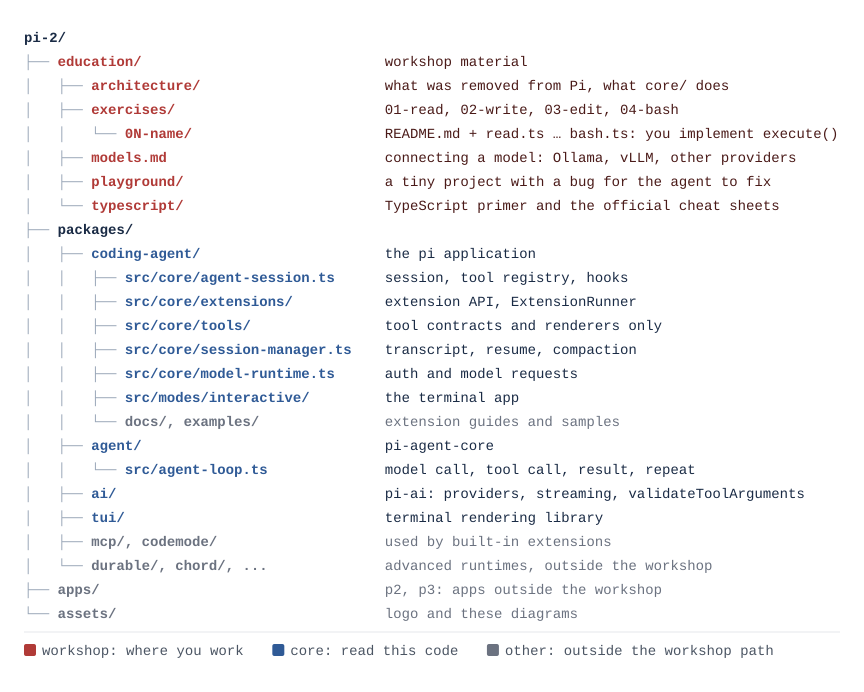

<p align="center">
  
</p>
<p align="center">
  <a href="https://discord.com/invite/3cU7Bz4UPx"></a>
  <a href="https://www.npmjs.com/package/@earendil-works/pi-coding-agent"></a>
</p>

> An educational fork of [Pi](https://github.com/earendil-works/pi) for workshops, with the built-in coding tools removed so you can build them yourself. The badges link to the original Pi community and npm package; this edition is not published to npm, so run it from source (see [Getting started](#getting-started)).

# Pi Workshop Edition (pi/2)

Pi Workshop Edition is an educational version of the [Pi agent framework](https://github.com/earendil-works/pi). It keeps Pi's architecture, packages and terminal UI, and removes the built-in coding tools (`read`, `write`, `edit`, `bash`, ...). In the workshop you write those tools yourself, as Pi extensions, and learn how a real agent works by completing it.

Start this edition without extensions and ask it to read a file: it cannot. The model is offered no tools. After the exercises it reads, writes, edits and runs code with tools you built.

## What you'll learn

- How an LLM provider, the agent loop and the terminal UI fit together in a real agent.
- How a tool call travels: from the model's request, through validation and execution, back to the model.
- How to define, register and implement tools with Pi's extension API.
- How to make tools safe: validating input, refusing ambiguous edits, isolating commands.

## The big picture

Before any detail: what the original Pi does with one prompt, step by step, with the code that does each step. Step 7 is what this edition removes and you build back.

<p align="center"></p>

## Architecture

<p align="center"></p>

`coding-agent` depends on `agent`, `ai` and `tui` (and on `mcp` and `codemode` for built-in extensions); `agent` depends on `ai`, whose `validateToolArguments` the loop uses. The loop does not choose a provider: `AgentSession`'s `streamFn` sends requests through `ModelRuntime`, which resolves auth and calls the pi-ai provider. Your extensions enter only through the extension API. See [education/architecture/](education/architecture/) for details.

## How a request becomes a tool call

<p align="center"></p>

The model decides which tool to call. Pi runs the tool lifecycle. You implement what the tool does.

## Learning path

The workshop gives a blind agent its senses and hands, one tool at a time. Every exercise adds a capability you can try on the spot, and each one builds on the last: the agent cannot fix code it cannot read, and cannot check a fix it cannot run.

<p align="center"></p>

| Stage | You leave with | Start here |
|---|---|---|
| 1 · Understand Pi | A map of the packages and where a request goes | [The big picture](#the-big-picture), [Architecture](#architecture), [External libraries](education/architecture/external-libraries.md) |
| 2 · Explore the agent | The tool-call cycle, traced in real source | [Sequence diagram](#how-a-request-becomes-a-tool-call), `packages/agent/src/agent-loop.ts` |
| 3 · Build the tools | An agent that reads, writes, edits and runs tests with your code | [Exercises](education/exercises/README.md), [TypeScript primer](education/typescript/README.md) |
| 4 · Extend | Ideas for your next tool, and a demo | [Extensions docs](packages/coding-agent/docs/extensions.md) |

By the end of stage 3 you can ask "run the tests and fix what fails", and watch the agent use all four of your tools to do it.

## Getting started

Requires Node.js 22.19 or newer, [Ollama](https://ollama.com) for the model, and Docker for exercise 04.

```bash
git clone https://github.com/windx987/pi-2.git
cd pi-2
npm install --ignore-scripts
npm run build
```

### Connect a model through Ollama

The workshop runs Gemma 4 through Ollama's OpenAI-compatible endpoint. Pi only needs the endpoint's address, so the model can run on your machine or on a shared server.

| Ollama runs on | `baseUrl` in `models.json` |
|---|---|
| Your machine | `http://localhost:11434/v1` |
| A shared workshop server | `http://<server-ip>:11434/v1` |

On the machine that runs Ollama, pull the model and give it a 32k context (Ollama's default of 4096 tokens is too small for Pi and cuts requests without an error):

```bash
ollama pull gemma4:12b                       # gemma4:31b needs about 20 GB of free memory
printf 'FROM gemma4:12b\nPARAMETER num_ctx 32768\n' > Modelfile
ollama create gemma4-workshop:12b -f Modelfile
```

For a shared server, start Ollama listening on all interfaces with `OLLAMA_HOST=0.0.0.0:11434 ollama serve`. Ollama has no authentication: anyone who can reach the port can use the model. Keep the server on the workshop network or behind a firewall that allows only participants' addresses, never open on the public internet.

On each participant's machine, add the endpoint to `~/.pi/agent/models.json`, with `localhost` replaced by the server's address when you use a shared server:

```json
{
  "providers": {
    "ollama": {
      "baseUrl": "http://localhost:11434/v1",
      "api": "openai-completions",
      "apiKey": "ollama",
      "compat": { "supportsDeveloperRole": false },
      "models": [
        { "id": "gemma4-workshop:12b", "name": "Gemma 4 12B (32k)", "contextWindow": 32768, "maxTokens": 8192 }
      ]
    }
  }
}
```

Check the endpoint, then start Pi from source with that model:

```bash
curl http://localhost:11434/v1/models          # lists gemma4-workshop:12b
./pi-test.sh --model ollama/gemma4-workshop:12b
```

Any other provider Pi supports works too: run `./pi-test.sh` and `/login`, or set an API key such as `ANTHROPIC_API_KEY`. Setup details are in [education/exercises/README.md](education/exercises/README.md).

## Building your first tool

A tool is a definition plus one function, registered by an extension:

```typescript
import { defineTool, type ExtensionAPI } from "@earendil-works/pi-coding-agent";
import { Type } from "typebox";

const hello = defineTool({
	name: "hello",
	label: "hello",
	description: "Greet someone by name",
	parameters: Type.Object({ name: Type.String() }),
	async execute(_toolCallId, params) {
		return { content: [{ type: "text", text: `Hello, ${params.name}!` }], details: undefined };
	},
});

export default function (pi: ExtensionAPI) {
	pi.registerTool(hello);
}
```

Load it with `./pi-test.sh -e hello.ts` and ask Pi to greet you.

## Workshop exercises

| Exercise | Tool | You learn |
|---|---|---|
| [01-read](education/exercises/01-read/README.md) | `read` | Arguments, filesystem access, error results |
| [02-write](education/exercises/02-write/README.md) | `write` | Structured input, validation, filesystem writes |
| [03-edit](education/exercises/03-edit/README.md) | `edit` | Exact matching, uniqueness, diffs, safe changes |
| [04-bash](education/exercises/04-bash/README.md) | `bash` | Processes, exit codes, isolation in Docker |

Start with [education/exercises/README.md](education/exercises/README.md). The full roadmap is in [education/README.md](education/README.md).

## Lobotomized: pi/2 in Python

[Lobotomized](https://github.com/windx987/pi-2/tree/python/python) is pi/2 cut down to about 800 lines of standard-library Python, on the `python` branch. It keeps the same eight steps as [the big picture](#the-big-picture), one file per step, and the same terminal look, so you can read the whole agent in one sitting. It drops what the path of one prompt does not need: Markdown rendering, session resume, compaction, and providers other than OpenAI-compatible ones such as Ollama. It has the exercises 01 to 04 as Python starters, plus a Python-only exercise 05: extensions that do more than one tool, such as a subagent.

## Project structure

<p align="center"></p>

You work in red: [education/](education). The blue paths are the Pi code the exercises point to: start with [agent-session.ts](packages/coding-agent/src/core/agent-session.ts) and [agent-loop.ts](packages/agent/src/agent-loop.ts). Grey parts are Pi's other packages and apps, which the workshop does not need.

## Development

```bash
npm run check   # lint, format, type check (including the exercises)
./test.sh       # tests without API keys
```

See [AGENTS.md](AGENTS.md) for project rules.

## Original Pi framework

This edition is based on [earendil-works/pi](https://github.com/earendil-works/pi) at commit `cead615b4`. The original tool implementations are in git history there: `git show cead615b4:packages/coding-agent/src/core/tools/read.ts`. What was removed and why: [education/architecture/tool-removal.md](education/architecture/tool-removal.md). For Pi itself, see [pi.dev](https://pi.dev) and the [Pi documentation](https://pi.dev/docs/latest).

## License

MIT, as the original Pi.
