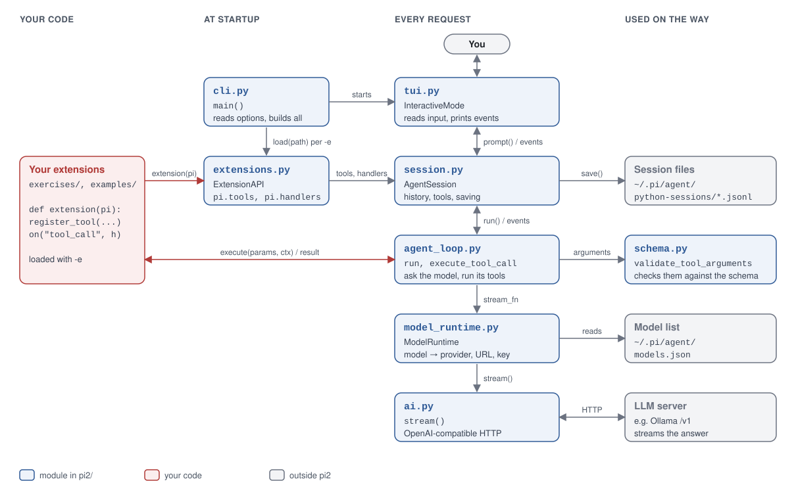
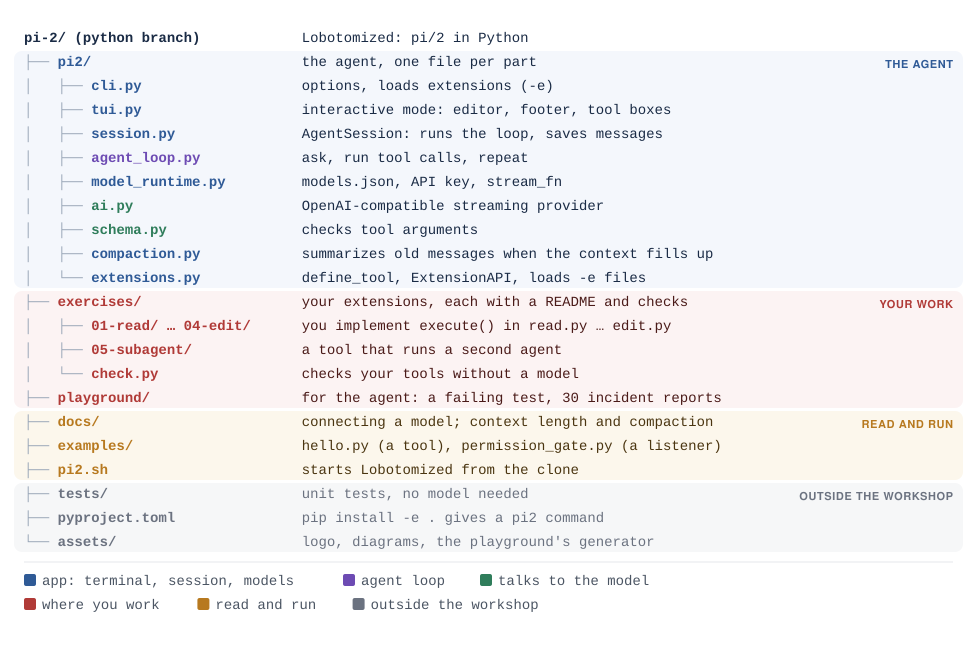

<p align="center">
  
</p>
<p align="center">
  <a href="https://discord.com/invite/3cU7Bz4UPx"></a>
  <a href="https://www.npmjs.com/package/@earendil-works/pi-coding-agent"></a>
</p>

> This is the `python` branch: only the Python version of pi/2. The TypeScript edition, with the full Pi framework it is modelled on, is on [`main`](https://github.com/windx987/pi-2).

# Lobotomized: pi/2 in Python

Lobotomized is a small Python version of pi/2, the Pi Workshop Edition. It follows the same eight steps as Pi, one file per step, in about 800 lines of standard-library Python. Its terminal looks and behaves like Pi's: the logo header, the editor between two borders, thinking in dim italics, tool calls in colored boxes, and the footer with tokens and model.

Like pi/2 it has no built-in tools. Every tool comes from an [extension](#extensions): you write `read`, `write`, `edit` and `bash` yourself, in [exercises/](exercises/).

## The big picture

What the original Pi does with one prompt, step by step, with the code that does each step. Lobotomized has the same steps in Python (see [the table below](#the-eight-steps-in-the-code)).

<p align="center"></p>

## Getting started

Requires Python 3.10 or newer and no packages, [Ollama](https://ollama.com) or [vLLM](#using-vllm-instead-of-ollama) for the model, and Docker for exercise 03.

```bash
git clone -b python https://github.com/windx987/pi-2.git
cd pi-2
```

Pull the model and give it a 32k context (Ollama's default of 4096 tokens is too small and cuts requests without an error):

```bash
ollama pull gemma4:12b
printf 'FROM gemma4:12b\nPARAMETER num_ctx 32768\n' > Modelfile
ollama create gemma4-workshop:12b -f Modelfile
```

Add the endpoint to `~/.pi/agent/models.json`, the same file Pi uses. For a shared Ollama server, replace `localhost` with its address:

```json
{
  "providers": {
    "ollama": {
      "baseUrl": "http://localhost:11434/v1",
      "api": "openai-completions",
      "apiKey": "ollama",
      "models": [
        { "id": "gemma4-workshop:12b", "name": "Gemma 4 12B (32k)", "contextWindow": 32768, "maxTokens": 8192 }
      ]
    }
  }
}
```

Then start it from the clone with the example tool, the way the TypeScript edition starts with `./pi-test.sh`:

```bash
./pi2.sh -e examples/hello.py
```

It starts with the first model in `models.json`. Type `/model` to list the others and `/model 2` to switch, or start with one: `./pi2.sh --model ollama/gemma4-workshop:12b`.

Ask it to greet someone. `pi2.sh` runs `python3 -m pi2` from the clone and works from any directory; set `PYTHON` to use another interpreter. To get a `pi2` command instead, run `pip install -e .` once.

| Key or command | Does |
|---|---|
| Enter | Send the message |
| ctrl+c | While the agent works: stop it. In the editor: clear it |
| ctrl+d | Exit |
| `/model` | List the models in `models.json`; `/model <number>` or `/model <provider/id>` switches |
| `/new`, `/quit`, `/help` | New session, exit, list commands |

Text you type while the agent works waits in the editor for the next message.

### Using vLLM instead of Ollama

pi2 talks to any OpenAI-compatible server, and [vLLM](https://docs.vllm.ai) is one. Start it with tool calling on: without `--enable-auto-tool-choice` and a `--tool-call-parser`, vLLM answers in text and never calls a tool. The parser depends on the model family: `hermes` for Qwen, `llama3_json` for Llama 3.x, `mistral` for Mistral.

```bash
vllm serve Qwen/Qwen3-8B --max-model-len 32768 --enable-auto-tool-choice --tool-call-parser hermes
```

Add it to `~/.pi/agent/models.json` next to (or instead of) `ollama`. The `id` is the model name vLLM serves. `apiKey` matters only if you started vLLM with `--api-key`; it can also name an environment variable, such as `"VLLM_API_KEY"`:

```json
{
  "providers": {
    "vllm": {
      "baseUrl": "http://localhost:8000/v1",
      "api": "openai-completions",
      "apiKey": "none",
      "models": [
        { "id": "Qwen/Qwen3-8B", "name": "Qwen3 8B (vLLM)", "contextWindow": 32768, "maxTokens": 8192 }
      ]
    }
  }
}
```

Then start with `./pi2.sh -e examples/hello.py --model vllm/Qwen/Qwen3-8B`, or switch with `/model` inside pi2.

## The eight steps in the code

| Step | Pi (TypeScript) | Lobotomized (Python) |
|---|---|---|
| 1. Interactive mode | [`modes/interactive/interactive-mode.ts`](https://github.com/windx987/pi-2/blob/main/packages/coding-agent/src/modes/interactive/interactive-mode.ts) | [pi2/tui.py](pi2/tui.py) `InteractiveMode.run` |
| 2. AgentSession | [`core/agent-session.ts`](https://github.com/windx987/pi-2/blob/main/packages/coding-agent/src/core/agent-session.ts) | [pi2/session.py](pi2/session.py) `AgentSession.prompt` |
| 3. Agent loop | [`packages/agent/src/agent-loop.ts`](https://github.com/windx987/pi-2/blob/main/packages/agent/src/agent-loop.ts) | [pi2/agent_loop.py](pi2/agent_loop.py) `run` |
| 4. streamFn and ModelRuntime | `core/sdk.ts`, `core/model-runtime.ts` | [pi2/model_runtime.py](pi2/model_runtime.py) `stream_fn` |
| 5. Provider → LLM | [`packages/ai/src/api/openai-completions.ts`](https://github.com/windx987/pi-2/blob/main/packages/ai/src/api/openai-completions.ts) | [pi2/ai.py](pi2/ai.py) `stream` |
| 6. Validate, then ask extensions | `validateToolArguments`, `beforeToolCall` | [pi2/schema.py](pi2/schema.py), `AgentSession.before_tool_call` |
| 7. Tool runs | your extension's `execute()` | your extension's `execute()`, called in `agent_loop.execute_tool_call` |
| 8. Result back, saved | `currentContext.messages.push`, `appendMessage` | `agent_loop.run`, `AgentSession.save` |

Read them in that order. [pi2/extensions.py](pi2/extensions.py) is how [extensions](#extensions) get in, and [pi2/cli.py](pi2/cli.py) starts everything.

## Architecture

<p align="center"></p>

Each module knows only its neighbours. `tui.py` talks only to the session. `agent_loop.py` knows no terminal and no provider: it gets `stream_fn` and `before_tool_call` from the session, and reports everything through `emit(event)`. `model_runtime.py` turns a model from `models.json` into a request for `ai.py`, the only module that speaks HTTP. Your extensions come in through `extensions.py` only. Pi has the same split across its packages: see [its architecture](https://github.com/windx987/pi-2#architecture) on `main`.

## How a request becomes a tool call

<p align="center"></p>

The numbers are the steps of [the big picture](#the-big-picture). The loop box repeats once per model answer: the conversation ends when the model answers without a tool call.

## Project structure

<p align="center"></p>

You work in red: your extensions, their instructions, and a copy of the [playground](playground/). The blue files are pi2, numbered by the steps of [the big picture](#the-big-picture): start with [session.py](pi2/session.py) and [agent_loop.py](pi2/agent_loop.py). Grey parts are not needed for the workshop.

## Extensions

An extension is any Python file you load with `-e`. It has one function, `extension(pi)`, which pi2 calls at startup with an `ExtensionAPI`. Everything the model can do comes from extensions: pi2 itself contains no tools. Start it without `-e` and the model cannot read, write or run anything.

<p align="center"></p>

Through `pi`, an extension can do two things:

| Call | Does | Step |
|---|---|---|
| `pi.register_tool(tool)` | Offers a tool to the model. Its `execute(params, ctx)` runs when the model calls it | 2, 7 |
| `pi.on("tool_call", handler)` | Sees every tool call before it runs. `handler(call, args)` returns a reason to block it, or `None` | 6 |

So one file can add a tool, put a rule on other files' tools, or both. These are all the extensions in this branch:

| File | Kind | What it shows |
|---|---|---|
| [examples/hello.py](examples/hello.py) | tool | The smallest tool |
| [examples/permission_gate.py](examples/permission_gate.py) | listener | Blocks dangerous commands sent to the `bash` tool |
| [exercises/01-read](exercises/01-read/starter.py) to [04-edit](exercises/04-edit/starter.py) | tool | The four coding tools, which you write; 01 to 03 show the solution in the Steps of their README |
| [exercises/05-subagent](exercises/05-subagent/starter.py) | tool | A tool that runs a second agent through `ctx.session` |

A tool extension:

```python
from pi2 import ExtensionAPI, define_tool


def execute(params, ctx):
    return f"Hello, {params['name']}!"


hello = define_tool(
    name="hello",
    label="hello",
    description="Greet someone by name",
    parameters={"type": "object", "properties": {"name": {"type": "string"}}, "required": ["name"]},
    execute=execute,
)


def extension(pi: ExtensionAPI):
    pi.register_tool(hello)
```

`define_tool` describes the tool to the model: its name, a description, and the JSON Schema of its arguments. pi2 checks the model's arguments against that schema before `execute` runs, so `params` always has the right shape. `ctx.cwd` is the directory the agent works in, and `ctx.session` is the running `AgentSession`. Return a string; raise an exception for an error result, whose message the model reads.

A listener extension:

```python
def on_tool_call(call, args):
    if call["name"] == "bash" and "rm -rf" in args["command"]:
        return "Dangerous command blocked"   # the tool does not run; the model reads this
    return None                              # let the call run


def extension(pi):
    pi.on("tool_call", on_tool_call)
```

Load several with repeated `-e`; they work together. Here is one run with both kinds, step by step: the real `examples/hello.py` and `examples/permission_gate.py` on the left, each line highlighted with the step that uses it, and what happens when you ask "Greet Ada." on the right.

<p align="center"></p>

In Pi it is the same idea in TypeScript: `export default function (pi: ExtensionAPI)` with `pi.registerTool` and `pi.on("tool_call")`, and [about 70 example extensions](https://github.com/windx987/pi-2/tree/main/packages/coding-agent/examples/extensions).

## Exercises

| Exercise | Tool | Instructions |
|---|---|---|
| [01-read](exercises/01-read/starter.py) | `read` | [README](exercises/01-read/README.md) |
| [02-write](exercises/02-write/starter.py) | `write` | [README](exercises/02-write/README.md) |
| [03-bash](exercises/03-bash/starter.py) | `bash` | [README](exercises/03-bash/README.md); test the timeout with [check_timeout.py](exercises/03-bash/check_timeout.py) |
| [04-edit](exercises/04-edit/starter.py) | `edit` | [README](exercises/04-edit/README.md) |
| [05-subagent](exercises/05-subagent/starter.py) | `subagent` | [README](exercises/05-subagent/README.md) (not in the TypeScript edition) |

Each README says what the tool does, the steps, what to ask the agent and what you should see; the starter's comments name the Python functions to use. Work in a copy of the playground under your home directory, never in the repository:

```bash
cp -R "$REPO/playground" ~/pi-workshop && cd ~/pi-workshop
"$REPO/pi2.sh" -e "$REPO/exercises/01-read/starter.py"
```

`REPO` is the path of your clone. After each exercise, add the next file with another `-e`; type `/new` to start over.

## What Pi does that Lobotomized leaves out

It keeps the path of one prompt and drops the rest: one provider API (`openai-completions`, which covers Ollama and vLLM), no Markdown rendering, no session resume, no compaction, no skills or slash-command extensions, no parallel tool calls, no image input. Sessions are saved to `~/.pi/agent/python-sessions/` but not loaded again.

## Tests

```bash
python3 -m unittest discover tests
```

The tests need no model: a fake stream function drives the agent loop, and a local HTTP server streams a recorded answer to the provider.

## License

MIT, as the original Pi.
