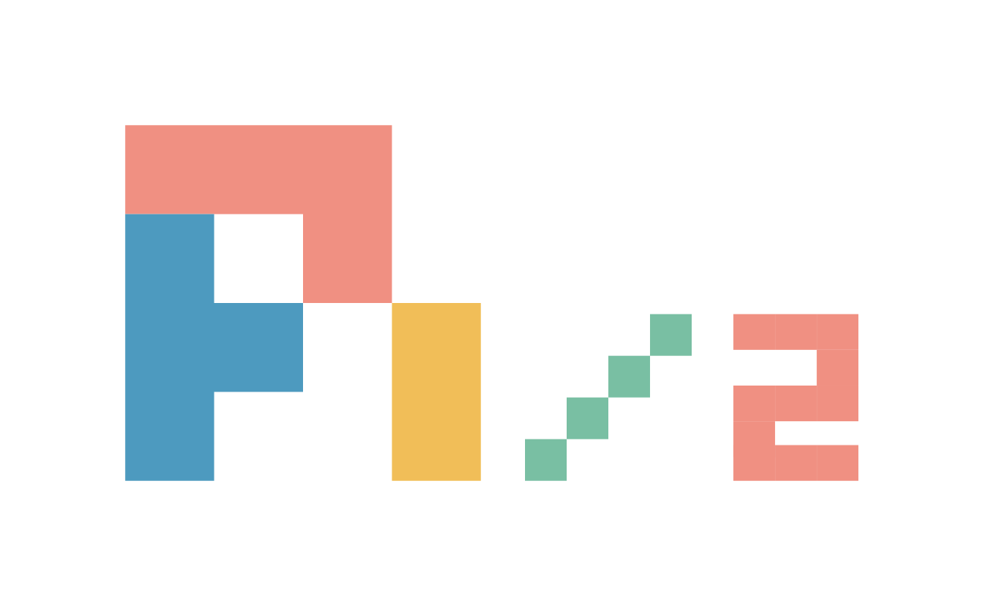
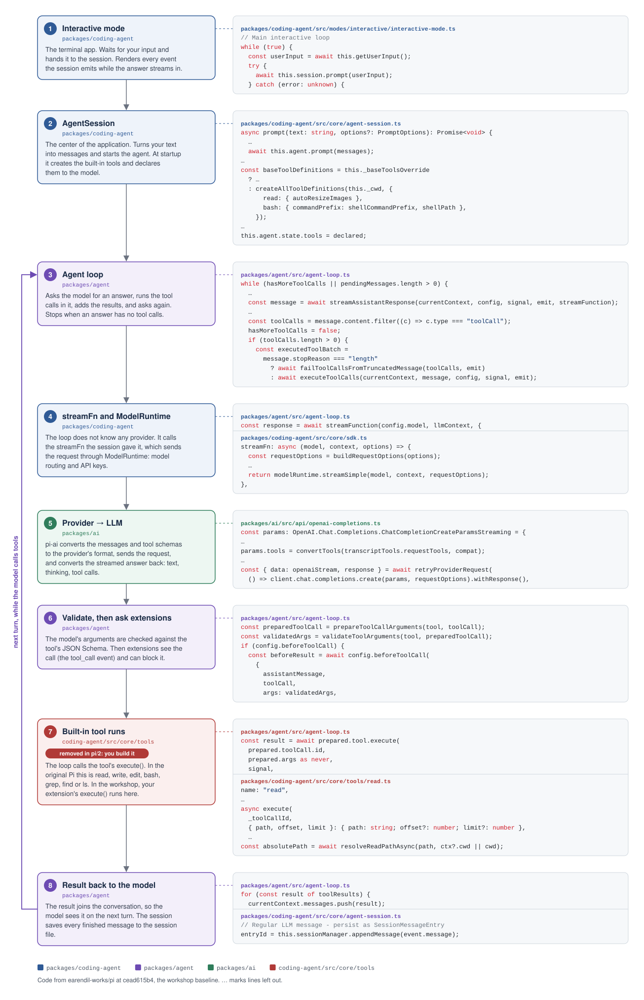

<p align="center">
  
</p>

> This is the `python` branch: pi/2 cut down to Python. The TypeScript edition, with the full Pi framework, is on [`main`](https://github.com/windx987/pi-2).

# Lobotomized: pi/2 in Python

Lobotomized is a small Python version of pi/2, the Pi Workshop Edition. It follows the same eight steps as Pi, one file per step, in about 800 lines of standard-library Python. Its terminal looks and behaves like Pi's: the logo header, the editor between two borders, thinking in dim italics, tool calls in colored boxes, and the footer with tokens and model.

Like pi/2 it has no built-in tools. You write `read`, `write`, `edit` and `bash` as extensions, in [python/exercises/](python/exercises/).

## The big picture

What the original Pi does with one prompt, step by step, with the code that does each step. Lobotomized has the same steps in Python (see [the table below](#the-eight-steps-in-the-code)).

<p align="center"></p>

## Getting started

Requires Python 3.10 or newer and no packages, [Ollama](https://ollama.com) for the model, and Docker for exercise 04.

```bash
git clone -b python https://github.com/windx987/pi-2.git
cd pi-2
```

Pull the model and give it a 32k context (Ollama's default of 4096 tokens is too small and cuts requests without an error):

```bash
ollama pull gemma4:12b
printf 'FROM gemma4:12b\nPARAMETER num_ctx 32768\n' > Modelfile
ollama create gemma4-workshop:12b -f Modelfile
```

Add the endpoint to `~/.pi/agent/models.json`, the same file Pi uses. For a shared Ollama server, replace `localhost` with its address:

```json
{
  "providers": {
    "ollama": {
      "baseUrl": "http://localhost:11434/v1",
      "api": "openai-completions",
      "apiKey": "ollama",
      "models": [
        { "id": "gemma4-workshop:12b", "name": "Gemma 4 12B (32k)", "contextWindow": 32768, "maxTokens": 8192 }
      ]
    }
  }
}
```

Then start it with the example tool:

```bash
cd python
python -m pi2 --model ollama/gemma4-workshop:12b -e examples/hello.py
```

Ask it to greet someone. To run `pi2` in any directory, install the command once with `pip install -e python`.

| Key or command | Does |
|---|---|
| Enter | Send the message |
| ctrl+c | While the agent works: stop it. In the editor: clear it |
| ctrl+d | Exit |
| `/new`, `/quit`, `/help` | New session, exit, list commands |

Text you type while the agent works waits in the editor for the next message.

## The eight steps in the code

| Step | Pi (TypeScript) | Lobotomized (Python) |
|---|---|---|
| 1. Interactive mode | `modes/interactive/interactive-mode.ts` | [python/pi2/tui.py](python/pi2/tui.py) `InteractiveMode.run` |
| 2. AgentSession | `core/agent-session.ts` | [python/pi2/session.py](python/pi2/session.py) `AgentSession.prompt` |
| 3. Agent loop | `packages/agent/src/agent-loop.ts` | [python/pi2/agent_loop.py](python/pi2/agent_loop.py) `run` |
| 4. streamFn and ModelRuntime | `core/sdk.ts`, `core/model-runtime.ts` | [python/pi2/model_runtime.py](python/pi2/model_runtime.py) `stream_fn` |
| 5. Provider → LLM | `packages/ai/src/api/openai-completions.ts` | [python/pi2/ai.py](python/pi2/ai.py) `stream` |
| 6. Validate, then ask extensions | `validateToolArguments`, `beforeToolCall` | [python/pi2/schema.py](python/pi2/schema.py), `AgentSession.before_tool_call` |
| 7. Tool runs | your extension's `execute()` | your extension's `execute()`, called in `agent_loop.execute_tool_call` |
| 8. Result back, saved | `currentContext.messages.push`, `appendMessage` | `agent_loop.run`, `AgentSession.save` |

Read them in that order. [python/pi2/extensions.py](python/pi2/extensions.py) is how tools get in, and [python/pi2/cli.py](python/pi2/cli.py) starts everything.

## Project structure

```
python/
├── pi2/                    the agent, one file per part
│   ├── cli.py              options (--model, -e), loads extensions, starts the UI
│   ├── tui.py              step 1: interactive mode
│   ├── session.py          step 2: AgentSession, tool_call hook, session file
│   ├── agent_loop.py       steps 3, 6, 7, 8: ask the model, run tool calls, repeat
│   ├── model_runtime.py    step 4: models.json, API key, stream_fn
│   ├── ai.py               step 5: OpenAI-compatible streaming provider
│   ├── schema.py           step 6: JSON Schema check of tool arguments
│   └── extensions.py       define_tool, ExtensionAPI, loading -e files
├── examples/hello.py       the smallest tool
├── exercises/              01-read … 04-bash starters, 05-extensions
└── tests/test_pi2.py       unit tests, no model needed
```

The rest of the repository is the TypeScript Pi this edition is modelled on. The 01 to 04 exercise instructions are in [education/exercises/](education/exercises/).

## Write a tool

```python
from pi2 import ExtensionAPI, define_tool


def execute(params, ctx):
    return f"Hello, {params['name']}!"


hello = define_tool(
    name="hello",
    label="hello",
    description="Greet someone by name",
    parameters={"type": "object", "properties": {"name": {"type": "string"}}, "required": ["name"]},
    execute=execute,
)


def extension(pi: ExtensionAPI):
    pi.register_tool(hello)
```

`execute(params, ctx)` gets the validated arguments, `ctx.cwd` (the directory the agent works in) and `ctx.session` (the running `AgentSession`). Return a string; raise an exception for an error result, whose message the model reads. `pi.on("tool_call", handler)` lets an extension block calls: `handler(call, args)` returns a reason to block, or `None`.

## Exercises

| Exercise | Tool | Instructions |
|---|---|---|
| [01-read](python/exercises/01-read/starter.py) | `read` | [README](education/exercises/01-read/README.md) |
| [02-write](python/exercises/02-write/starter.py) | `write` | [README](education/exercises/02-write/README.md) |
| [03-edit](python/exercises/03-edit/starter.py) | `edit` | [README](education/exercises/03-edit/README.md) |
| [04-bash](python/exercises/04-bash/starter.py) | `bash` | [README](education/exercises/04-bash/README.md) |
| [05-extensions](python/exercises/05-extensions/README.md) | `subagent`, a permission gate | [README](python/exercises/05-extensions/README.md) (Python only) |

The READMEs for 01 to 04 are the TypeScript exercises'; the tasks are the same, and each starter's comments name the Python functions to use. Work in a copy of the playground under your home directory, never in the repository:

```bash
cp -R education/playground ~/pi-workshop && cd ~/pi-workshop
PYTHONPATH="$REPO/python" python -m pi2 -e "$REPO/python/exercises/01-read/starter.py"
```

`REPO` is the path of your clone. After `pip install -e python`, `pi2 -e ...` works without `PYTHONPATH`.

## What Pi does that Lobotomized leaves out

It keeps the path of one prompt and drops the rest: one provider API (`openai-completions`, which covers Ollama), no Markdown rendering, no session resume, no compaction, no skills or slash-command extensions, no parallel tool calls, no image input. Sessions are saved to `~/.pi/agent/python-sessions/` but not loaded again.

## Tests

```bash
cd python
python -m unittest discover tests
```

The tests need no model: a fake stream function drives the agent loop, and a local HTTP server streams a recorded answer to the provider.

## License

MIT, as the original Pi.
