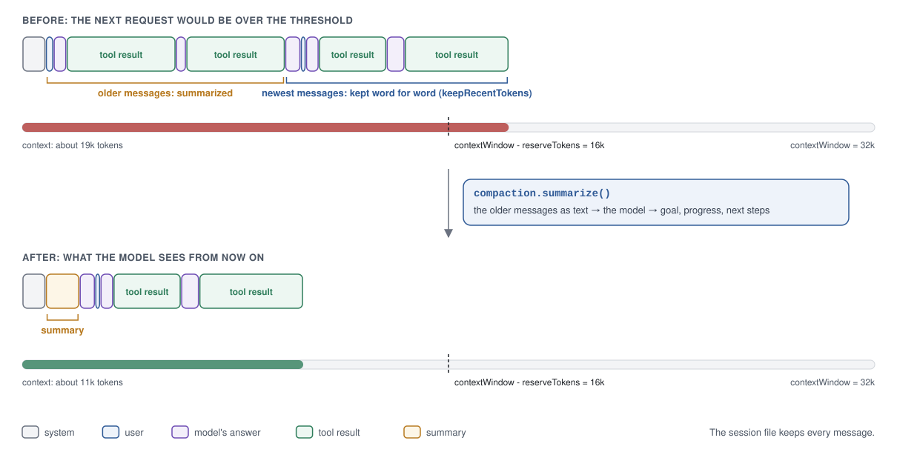

# Context length and compaction

Every request sends the whole conversation: the system prompt, your messages, the model's answers and every tool result. The footer shows how much of the model's `contextWindow` from `models.json` that is. When it gets close, [compaction.py](../pi2/compaction.py) makes room, as Pi does:

<p align="center"></p>

## How it works

1. **When.** Before each prompt and between turns, after the tool results are added, the session checks `context > contextWindow - reserveTokens`. The context is the model's last token count plus an estimate of the messages after it; before the model has counted, as at the start or right after a compaction, the system prompt and tool definitions are estimated too.
2. **What it keeps.** About `keepRecentTokens` of the newest messages, word for word. The cut never separates a tool call from its result.

   Estimates count four characters per token, times a ratio the session learns from the model's last count. Four characters is right for prose, but logs, numbers and IDs have about twice as many tokens: without the ratio, the kept messages would be twice as large as `keepRecentTokens`, still over the threshold, and the session would compact again on every turn.
3. **What it summarizes.** The older messages go to the model as plain text, with a request for a structured summary: goal, constraints, progress, key decisions, next steps, critical context. Files that `read`, `write` and `edit` touched are listed under it. A second compaction updates the first summary.
4. **What the model sees next.** The system prompt, the summary as a user message, then the kept messages. The session file keeps every message.

If the server still rejects a request as too long, the session compacts and retries once.

## What you see

When it compacts by itself, a dim line says why: "Context is filling up: summarizing older messages..." (or "Context too long" after a rejected request). Then a box shows what happened and the start of the summary:

```
 Compacted 9 messages, 19k → about 7k tokens

 ## Goal
 Fix the failing test in calc.py.
 ## Constraints & Preferences
 - Keep the public API of calc.py unchanged.
 ... (18 more lines)
```

The footer's percentage drops to match. The agent goes on with its task: compaction happens between turns, not instead of one.

## Looking inside: `/context`

The footer gives one number. `/context` shows where it comes from:

```
 Context about 15k of 33k tokens (46%) · compacts above 16k
 ██████████████████░░│░░░░░░░░░░░░░░░░░░░

 system prompt      310
 tools              640  (4)
 summary           1.3k  (1 message)
 your messages      120  (3 messages)
 answers           2.1k  (9 messages)
 tool results       10k  (8 messages)

 Parts are estimates (4 characters per token, times 1.4 from the model's last count).
```

The bar is the window, and `│` marks where automatic compaction starts. The total is the same as the footer's: the model's last count plus an estimate of what came after it. The parts are estimates, scaled by the ratio when the model counted more tokens than four characters each, so their sum is close to the total but not equal. Tool results are usually the largest part: that is what `/compact`, and exercise 05's subagent, make smaller.

## Compacting by hand: `/compact`

Type `/compact` in the editor to compact now, even below the threshold. Use it:

- before you switch to another task in the same session, so the old details stop taking room;
- after the agent has read large files it no longer needs;
- when the footer is close to the threshold and the next step will read more.

`/compact <focus>` adds your text to the request for the summary, so it keeps what matters to you: `/compact keep the exact error message of the failing test`. When the conversation is shorter than what is kept anyway, it says "Nothing to compact yet". ctrl+c stops a compaction and leaves the conversation as it was; so does a failed summary request, which shows its error.

A summary loses detail: exact file contents, long outputs, earlier reasoning. The model can read a file again, but it cannot recover what you said only once. Put that in the focus, or say it again after compacting.

## Settings

| Setting in `~/.pi/agent/settings.json` | Default | Meaning |
|---|---|---|
| `compaction.enabled` | `true` | Compact automatically |
| `compaction.reserveTokens` | 16384, at most half the window | Room left for the answer |
| `compaction.keepRecentTokens` | 20000, at most an eighth of the window | Newest messages kept word for word |

Pi uses 16384 and 20000 for every model. pi2 caps them for small windows, so that a 32k model compacts at 16k and keeps 4k: with Pi's numbers, the kept messages alone would be over the threshold and it would compact again on every turn. Keeping only 4k also leaves `/compact` something to summarize long before the threshold.

The code is [pi2/compaction.py](../pi2/compaction.py), called from `AgentSession` in [pi2/session.py](../pi2/session.py). Pi's version, with split turns, branch summaries and extension hooks, is described in [its compaction reference](https://github.com/windx987/pi-2/blob/main/packages/coding-agent/docs/compaction.md).
