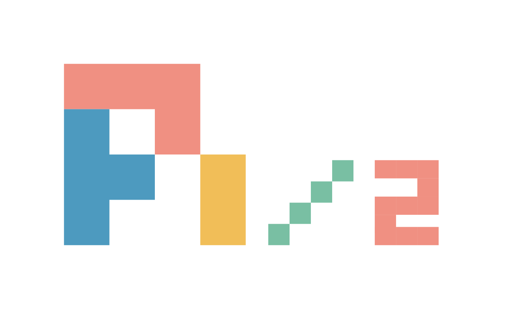

<p align="center">
  
</p>

> The Windows setup guide, in PowerShell. The [README](../README.md) has the short version. Tested on Windows 11 with PowerShell 5.1, Python 3.12, Git for Windows 2.56, Node.js 26 and Docker Desktop 29.

# pi/2 for Python on Windows

A small coding agent in Python, made to learn how an AI agent works. It starts with no tools: you write `read`, `write`, `bash` and `edit` yourself, in [exercises/](../exercises/), and then watch the agent use them to read, run and fix code.

## Getting started

You need Python 3.10 or newer (no packages), Git for Windows, a model served by [Ollama](https://ollama.com) or [vLLM](https://docs.vllm.ai), and, for exercise 03, Docker Desktop or the no-Docker mode (step 4). Run every command in PowerShell.

### 1. Python and Git

```powershell
winget install -e --id Python.Python.3.12
winget install -e --id Git.Git
```

Open a new PowerShell window, so it finds them, and check:

```powershell
py --version        # 3.10 or newer
git --version
```

Use `py`, not `python`: on many Windows machines `python` opens the Microsoft Store, even after the install. Nothing else to install: pi2 uses only the standard library. Git for Windows also brings Git Bash, which the no-Docker mode uses (step 4).

### 2. The code

Clone the `python` branch into `$HOME\pi-2`. Every command in this guide uses that path; if you clone somewhere else, change `$HOME\pi-2` in them to your path.

```powershell
git clone -b python https://github.com/windx987/pi-2.git $HOME\pi-2
cd $HOME\pi-2
```

Check that it starts, without a model:

```powershell
py pi2.py --version
```

It should print `0.1.0`.

### 3. A model

pi2 talks to any server with an OpenAI-compatible `POST /chat/completions` endpoint, such as Ollama or vLLM. Tell it where in `$HOME\.pi\agent\models.json`, the same file Pi uses:

```json
{
  "providers": {
    "vllm": {
      "baseUrl": "http://localhost:8000/v1",
      "api": "openai-completions",
      "apiKey": "none",
      "models": [
        { "id": "Qwen/Qwen3-8B", "name": "Qwen3 8B", "contextWindow": 32768, "maxTokens": 8192 }
      ]
    }
  }
}
```

Create the folder and open the file:

```powershell
New-Item -ItemType Directory -Force $HOME\.pi\agent
notepad $HOME\.pi\agent\models.json
```

Paste the example and replace `baseUrl`, `apiKey`, `id` and the limits with your server's values. At a workshop, the instructor gives you the address, key and model id of a shared server. The file holds your key: keep it out of shared folders.

To keep the config with the project instead, put it in `.pi-agent\models.json` (it is in `.gitignore`) and pass `--agent-dir .pi-agent`:

```powershell
New-Item -ItemType Directory -Force .pi-agent
Copy-Item $HOME\.pi\agent\models.json .pi-agent\models.json
py pi2.py --agent-dir .pi-agent -e examples\hello.py
```

- `contextWindow` is how many tokens the model takes: at least 32k, and what the server really allows. pi2 compacts when the conversation nears it.
- `maxTokens` caps each answer.

[models.md](models.md) has the setups step by step: Ollama on your machine, vLLM on a GPU server, and several models in one file.

### 4. Docker, or the no-Docker mode (for exercise 03)

Exercise 03's bash tool runs the commands the model writes. Choose where; you can switch any time. Exercises 01 and 02 need neither, so you can start before this is set up.

| | Docker Desktop (recommended) | No-Docker mode |
|---|---|---|
| Commands run | in a new container that sees only the working directory, without network | in Git Bash on your machine, in the working directory |
| A wrong command can | change the working directory only | reach your files, your network, everything your user may do |
| Setup | option 1 below | option 2 below |
| Start pi2 with | `py pi2.py ...` | `$env:PI2_NO_DOCKER = "1"`, then `py pi2.py ...` |

**Option 1: Docker Desktop (recommended)**

```powershell
winget install -e --id Docker.DockerDesktop
```

Start Docker Desktop from the Start menu and wait until it says it is running. Then pull the image once and try it:

```powershell
docker pull node:22-bookworm-slim
docker run --rm node:22-bookworm-slim node --version
```

**Option 2: no Docker**

The commands run on your machine, so what they call must be installed there. The playground's tests need Node.js 22 or newer, which brings `npm` with it (in option 1 the container image has them):

```powershell
winget install -e --id OpenJS.NodeJS.LTS
```

Open a new PowerShell window, then check that the playground's tests run:

```powershell
node --version      # v22 or newer
cd $HOME\pi-2\playground
npm test            # pass 1, fail 1
```

If PowerShell says running scripts is disabled, run `npm.cmd test` instead: it is the same npm, without the PowerShell script. The failing test is the bug the agent fixes in exercise 04. Then turn the mode on:

```powershell
$env:PI2_NO_DOCKER = "1"     # for this PowerShell window; Remove-Item env:PI2_NO_DOCKER turns it off
```

The bash tool then runs each command in Git Bash, in the working directory: not in `C:\Windows\System32\bash.exe`, which is WSL's Linux. `py exercises\check.py 03` always runs the "(no Docker)" checks, with or without Docker installed; they show TODO until you write the tool. Because nothing isolates the commands, work only in `playground\`, load [the permission gate](../playground/README.md#4-a-permission-gate) with your tools, and read each command before the agent's next step. [Exercise 03](../exercises/03-bash/README.md#try-it) has the details.

### 5. Start pi2

Start it from the clone with the example tool:

```powershell
py pi2.py -e examples\hello.py
```

It starts with the first model in `models.json`. Type `/model` to list the others and `/model 2` to switch, or start with one: `py pi2.py --model ollama/gemma4-workshop:12b`.

Ask it to greet someone. For the workshop, work in the repository playground:

```powershell
py pi2.py --cwd playground -e exercises\01-read\read.py
```

Reset between exercises with `git restore playground; git clean -fd playground`. Windows Terminal, the default on Windows 11, shows the colors and boxes; the older console windows do too.

| Key or command | Does |
|---|---|
| Enter | Send the message |
| ctrl+c | While the agent works: stop it. In the editor: clear it |
| ctrl+z, then Enter | Exit |
| `/model` | List the models in `models.json`; `/model <number>` or `/model <provider/id>` switches |
| `/compact [focus]` | Summarize the older messages now to free context; the optional text says what the summary must keep. See [compaction.md](compaction.md) |
| `/context` | Show how full the context window is, where compaction starts, and what fills it. See [compaction.md](compaction.md) |
| `/new`, `/quit`, `/help` | New session, exit, list commands |

Text you type while the agent works waits for the next message.

## Architecture

How the modules fit together, and where to start reading: [architecture.md](architecture.md).

[Structure](structure.md) shows where each file is, [request.md](request.md) follows one request step by step, and [compaction.md](compaction.md) explains what happens when the conversation fills the model's context.

## Extensions

An extension is any Python file you load with `-e`. It has one function, `extension(pi)`, which pi2 calls at startup with an `ExtensionAPI`. Everything the model can do comes from extensions: pi2 itself contains no tools.

| Call | Does |
|---|---|
| `pi.register_tool(tool)` | Offers a tool to the model. Its `execute(params, ctx)` runs when the model calls it |
| `pi.on("tool_call", handler)` | Sees every tool call before it runs. `handler(call, args)` returns a reason to block it, or `None` |

```python
from pi2 import ExtensionAPI


def extension(pi: ExtensionAPI):
    pi.register_tool(my_tool)
```

See [examples/hello.py](../examples/hello.py) for the smallest tool, [examples/permission_gate.py](../examples/permission_gate.py) for a listener, and [exercises/](../exercises/) for the tools you write. How the modules fit together is in [architecture.md](architecture.md).

## Exercises

| Exercise | Tool | Instructions |
|---|---|---|
| [01-read](../exercises/01-read/read.py) | `read` | [README](../exercises/01-read/README.md) |
| [02-write](../exercises/02-write/write.py) | `write` | [README](../exercises/02-write/README.md) |
| [03-bash](../exercises/03-bash/bash.py) | `bash` | [README](../exercises/03-bash/README.md); with Docker running, the checks also use a real container; `$env:PI2_NO_DOCKER = "1"` runs it without Docker |
| [04-edit](../exercises/04-edit/edit.py) | `edit` | [README](../exercises/04-edit/README.md) |
| [05-subagent](../exercises/05-subagent/subagent.py) | `subagent` | [README](../exercises/05-subagent/README.md) (not in the TypeScript edition) |

Each README says what the tool does, the steps, what to ask the agent and what you should see; the starter's comments name the Python functions to use. Work in the repository playground, from the clone:

```powershell
py pi2.py --cwd playground -e exercises\01-read\read.py
```

After each exercise, add the next file with another `-e`; type `/new` to start over. Reset between exercises with `git restore playground; git clean -fd playground`.

Check a tool without a model before you try it: `py exercises\check.py 01` runs the checks of exercise 01 against its `read.py` and shows PASS, FAIL or TODO for each step. `py exercises\check.py` checks all five, and `py exercises\check.py 01 path\to\my_read.py` checks another file.

## Playground

[playground/](../playground/README.md) is what the agent works on, from a small project to more than one context can hold.

| Scenario | Tools | What it shows |
|---|---|---|
| [A failing test](../playground/README.md#1-a-failing-test): `math.js` | read, write, bash, edit | The tool-call loop: read, run, fix, run again (exercises 01 to 04) |
| [Thirty incident reports](../playground/README.md#2-thirty-incident-reports): `incidents/` | read, subagent | More than one context holds: subagents read, the parent gets the answers (exercise 05) |
| [Watching the context](../playground/README.md#3-watching-the-context-context-compact-new): `incidents/` | read | `/context`, `/compact`, automatic compaction and `/new`, step by step |
| [A permission gate](../playground/README.md#4-a-permission-gate): `examples/permission_gate.py` | read, write, bash, the gate | A listener blocks `rm -rf` and `sudo` before they run |

[playground/README.md](../playground/README.md) has, for each scenario, a picture of what the agent does with a hint, why those tools fit, what to ask, and what to look for. `incidents/` is generated by [assets/playground/generate.py](../assets/playground/generate.py); `--answers` prints the answers for the instructor.

## Reading the guides on Windows

The exercise and playground guides show macOS and Linux commands. In PowerShell:

| Guide | PowerShell |
|---|---|
| `python3 pi2.py --cwd playground -e exercises/01-read/read.py` | `py pi2.py --cwd playground -e exercises\01-read\read.py` |
| `python3 exercises/check.py 01` | `py exercises\check.py 01` |
| `PI2_NO_DOCKER=1 python3 ...` | `$env:PI2_NO_DOCKER = "1"`, then `py ...` |
| `git restore playground && git clean -fd playground` | `git restore playground; git clean -fd playground` |
| `\` at the end of a line | `` ` `` (backtick) at the end of a line |

The guides use relative paths from the clone. If you do use a home path in PowerShell, write `$HOME`, not `~`.

The commands the agent runs with the bash tool stay bash commands, such as `npm test`: they run in the container or in Git Bash.

## What is different on Windows

- **Stopping a command.** On macOS and Linux, `proc.terminate()` sends a signal that `docker run` passes on to the container. On Windows it ends one process at once, which would leave the container running. [pi2/windows.py](../pi2/windows.py) runs the command under a watchdog that removes the container and the commands it started. Your `execute()` in exercise 03 stays the same, and the checks test it on Windows too.
- **Keys typed while the agent works** show on the screen; on macOS and Linux they are hidden until the next editor. They still wait for the next message.
- **Sessions** are saved in `$HOME\.pi\agent\python-sessions`.

## License

MIT, as the original Pi.
