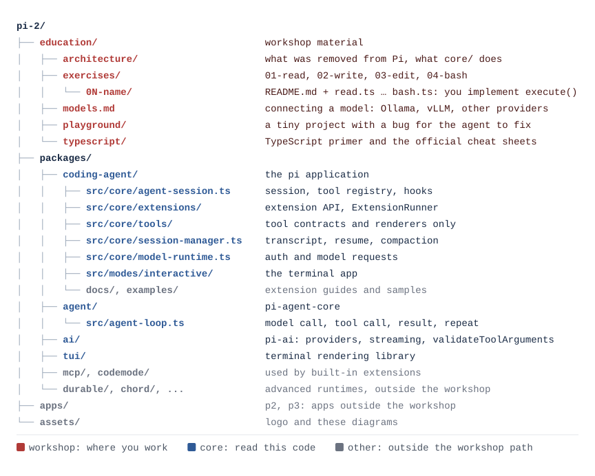

# Workshop roadmap

This directory is the educational layer of Pi Workshop Edition. It adds material next to Pi's packages and does not change their structure.

You work in red, in this directory. The blue paths are the Pi code the exercises point to. Grey parts are not needed for the workshop.

| Path | Contents |
|---|---|
| [architecture/tool-removal.md](architecture/tool-removal.md) | What was removed from Pi, what was kept, and why |
| [architecture/external-libraries.md](architecture/external-libraries.md) | The outside libraries Pi uses, and where |
| [architecture/core.md](architecture/core.md) | What each file in `coding-agent/src/core/` does, and how compaction keeps the context in the window |
| [exercises/](exercises/README.md) | The four tool exercises: README and starter extension each |
| [playground/](playground/README.md) | A tiny project for the agent to work on, used from a copy |
| [typescript/](typescript/README.md) | TypeScript basics for the exercises, with the official cheat sheets |

## Levels

**1. Understand the application.** Start with [the big picture](../README.md#the-big-picture): one prompt through the original Pi, each step with its code. Then what the packages do and how they depend on each other: the architecture diagram in the [root README](../README.md#architecture), then `packages/coding-agent/src/core/agent-session.ts` as the center of the application. [What is in core/](architecture/core.md) maps the files around it, including how Pi compacts a long session. [External libraries](architecture/external-libraries.md) shows what Pi builds itself and what it takes from outside.

**2. Explore the agent.** How a prompt becomes model requests and tool calls: the [sequence diagram](../README.md#how-a-request-becomes-a-tool-call), then `packages/agent/src/agent-loop.ts`.

**3. Build your own tools.** [Exercises 01 to 04](exercises/README.md): read, write, edit, bash. New to TypeScript? Read [TypeScript for the workshop](typescript/README.md) first.

**4. Extend the framework.** Pi's extension documentation covers events, commands, skills and MCP: [extensions.md](../packages/coding-agent/docs/extensions.md), [skills.md](../packages/coding-agent/docs/skills.md), [mcp.md](../packages/coding-agent/docs/mcp.md), and the examples in [packages/coding-agent/examples/extensions/](../packages/coding-agent/examples/extensions/).

## For instructors

Reference solutions are not in this repository's `main` branch. The original Pi implementations are in git history at the baseline commit, for example `git show cead615b4:packages/coding-agent/src/core/tools/edit.ts`.
