# External libraries

Pi writes most of its own infrastructure: the agent loop, JSON Schema validation, the terminal UI, sessions and the extension system are Pi code. It uses outside libraries at the edges, where a library is the standard way to talk to something else: a provider's API, the network, the filesystem, the terminal.

This page lists the runtime dependencies of the four packages the workshop uses, what each one does, and where Pi calls it. Versions are pinned exactly in each `package.json`.

## How the packages depend on each other

Solid arrows are Pi's own packages, dotted arrows outside libraries. Green packages have no outside libraries.

## packages/ai: talking to model providers

| Library | What it does | Where Pi uses it |
|---|---|---|
| `openai` | OpenAI's official SDK | `src/api/openai-completions.ts`, `openai-responses.ts` and the other OpenAI-compatible APIs. Ollama, LM Studio and vLLM go through `openai-completions` too |
| `@anthropic-ai/sdk` | Anthropic's official SDK | `src/api/anthropic-messages.ts` |
| `@google/genai` | Google's Gemini and Vertex AI SDK | `src/api/google-generative-ai.ts`, `google-vertex.ts`, `google-shared.ts` |
| `@aws-sdk/client-bedrock-runtime` | Amazon Bedrock client | `src/api/bedrock-converse-stream.ts` |
| `@smithy/node-http-handler`, `http-proxy-agent`, `https-proxy-agent` | HTTP transport for the AWS SDK, and proxy support for it | `src/api/bedrock-converse-stream.ts` |
| `partial-json` | Parses JSON that is still streaming in, such as half-received tool call arguments | `src/utils/json-parse.ts` |

Each provider SDK only sends requests and parses responses. Pi turns every provider's stream into the same events and messages, so the agent loop never sees which provider answered.

Tool arguments are validated with Pi's own `@earendil-works/pi-schema` (`validateToolArguments` in `src/utils/validation.ts`), not with an outside validator.

## packages/agent: the agent loop

`agent` (pi-agent-core) has no outside libraries at all. The agent loop is plain TypeScript on top of `ai`, which is why it is a good file to read in full.

## packages/coding-agent: the application

The three libraries in red are the ones the exercises touch.

| Library | What it does | Where Pi uses it |
|---|---|---|
| `typebox` | Builds JSON Schemas in TypeScript with matching types (`Type.Object`, `Static<typeof schema>`) | Tool parameters in extensions, including the exercise starters; settings and keybinding schemas |
| `jiti` | Loads TypeScript files at runtime without a build step | `src/core/extensions/loader.ts`: this is how `-e starter.ts` runs your extension directly |
| `undici` | Node's HTTP client, configured once for all requests | `src/core/http-dispatcher.ts`: proxies and timeouts for provider requests |
| `diff` | Computes line diffs | `src/core/tools/edit-diff.ts` and the diff view in the TUI; the edit exercise uses it for its result |
| `cross-spawn` | Starts child processes the same way on every OS | `src/utils/child-process.ts`, used for the `!` shell and package commands |
| `highlight.js` | Syntax highlighting | `src/utils/syntax-highlight.ts`, for code blocks and diffs in the TUI |
| `lovely-mermaid` | Draws Mermaid diagrams as text | `src/modes/interactive/components/mermaid.ts` |
| `@silvia-odwyer/photon-node` | Image processing in WebAssembly | `src/utils/photon.ts`: resizing and converting pasted images |
| `yaml` | YAML parser | `src/utils/frontmatter.ts`: the frontmatter of skills and prompt templates |
| `ignore` | `.gitignore` style matching | `src/core/skills.ts`, `src/core/package-manager.ts` |
| `minimatch`, `brace-expansion` | Glob patterns such as `claude-*` or `{a,b}` | `src/core/model-resolver.ts` (model patterns), `src/core/package-manager.ts` |
| `semver` | Version comparison | `src/core/package-manager.ts`, `src/utils/version-check.ts` |
| `hosted-git-info` | Understands GitHub and GitLab URLs | `src/utils/git.ts`, for installing Pi packages from git |
| `proper-lockfile` | File locks between processes | `src/core/settings-manager.ts`, `src/core/auth-storage.ts`: two Pi processes do not overwrite each other's settings or credentials |
| `chalk` | Colors in plain terminal output | `src/main.ts` and the CLI commands outside the TUI |
| `quickjs-wasi` | A JavaScript engine in WebAssembly | The sandbox the `codemode` package runs code in; `src/bun/runtime-setup.ts` embeds its WebAssembly file in standalone binaries |

## packages/tui: the terminal

| Library | What it does | Where Pi uses it |
|---|---|---|
| `marked` | Markdown parser | `src/components/markdown.ts`: the model's answers are Markdown, rendered as terminal text |
| `marked-cjk-friendly` | Correct emphasis around Chinese, Japanese and Korean text | `src/components/markdown.ts` |
| `get-east-asian-width` | How many terminal columns a character takes | `src/utils.ts`: wide characters and emoji would otherwise break line wrapping |

Everything else in the TUI, including the differential rendering that redraws only changed lines, is Pi's own code.

## What the exercises use

Your extensions import only two things:

- `@earendil-works/pi-coding-agent` for `defineTool` and the `ExtensionAPI` type,
- `typebox` for `Type`, to describe the tool's parameters.

Both are provided by Pi when it loads your extension with `jiti`, so the exercises need no `npm install`. Inside `execute()` you use Node's standard library (`node:fs/promises`, `node:path`, `node:child_process`); the edit exercise can also use the `diff` helpers Pi exports.

## Development tools

The repository root adds tools for building and checking, which are not part of Pi at runtime: TypeScript, Biome (lint and format), esbuild (bundling) and Vitest (tests).
