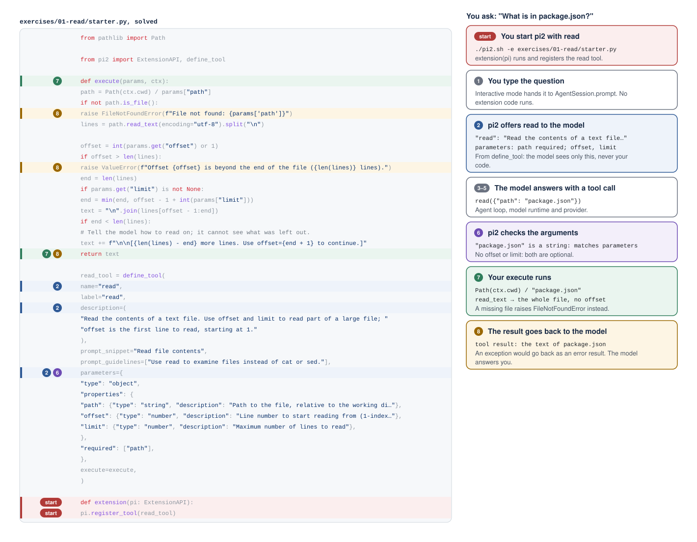
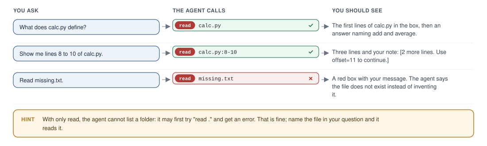

# Exercise 01: read

Give the agent its first tool: reading a file in the folder it works in.

## What you write

`execute(params, ctx)` in [read.py](read.py). The tool is already defined and registered; pi2 calls `execute` when the model asks to read a file.

| Name | Is |
|---|---|
| `params["path"]` | The file the model asks for, relative to the working folder or absolute |
| `params.get("offset")` | First line to read, from 1 (optional) |
| `params.get("limit")` | How many lines to read (optional) |
| `ctx.cwd` | The working folder |

Return the text as a string. Raise an exception for an error: the model reads its message.

## Steps

Follow EXERCISE 1 to 4 in [read.py](read.py). Add `from pathlib import Path` at the top.

1. Find the file in the working folder.

   ```python
   path = Path(ctx.cwd) / params["path"]
   ```

2. Stop if it is missing.

   ```python
   if not path.is_file():
       raise FileNotFoundError(f"File not found: {params['path']}")
   ```

3. Read it as lines.

   ```python
   lines = path.read_text(encoding="utf-8").split("\n")
   ```

4. Keep only the lines asked for, and say how to read on.

   ```python
   offset = int(params.get("offset") or 1)
   if offset > len(lines):
       raise ValueError(f"Offset {offset} is beyond the end of the file ({len(lines)} lines).")
   end = len(lines)
   if params.get("limit") is not None:
       end = min(end, offset - 1 + int(params["limit"]))
   text = "\n".join(lines[offset - 1:end])
   if end < len(lines):
       text += f"\n\n[{len(lines) - end} more lines. Use offset={end + 1} to continue.]"
   return text
   ```

   `offset` counts from 1, Python from 0. The note at the end tells the model which call reads the rest: it cannot see what was left out.

The four blocks, one under the other, are the whole function. The picture shows which lines run when you ask a question:

<p align="center"></p>

<details>
<summary>The whole function</summary>

```python
from pathlib import Path


def execute(params, ctx):
    path = Path(ctx.cwd) / params["path"]
    if not path.is_file():
        raise FileNotFoundError(f"File not found: {params['path']}")
    lines = path.read_text(encoding="utf-8").split("\n")

    offset = int(params.get("offset") or 1)
    if offset > len(lines):
        raise ValueError(f"Offset {offset} is beyond the end of the file ({len(lines)} lines).")
    end = len(lines)
    if params.get("limit") is not None:
        end = min(end, offset - 1 + int(params["limit"]))
    text = "\n".join(lines[offset - 1:end])
    if end < len(lines):
        # Tell the model how to read on; it cannot see what was left out.
        text += f"\n\n[{len(lines) - end} more lines. Use offset={end + 1} to continue.]"
    return text
```

</details>

## Check

```bash
python3 exercises/check.py 01
```

Each check calls your `execute()` without a model and shows PASS, FAIL or TODO.

## Try it

From the repository root:

```bash
python3 pi2.py --cwd playground -e exercises/01-read/read.py
```

| Ask | You should see |
|---|---|
| What does calc.py define? | A green `read calc.py` box, then an answer naming `add` and `average` |
| Show me lines 8 to 10 of calc.py. | `read calc.py:8-10`: three lines and your note |
| Read missing.txt. | A red box with your message; the agent says the file does not exist |

<p align="center"></p>

With only `read`, the agent cannot list a folder: name the file in your question.

## Read more

- [pi2/extensions.py](../../pi2/extensions.py): `define_tool` and `register_tool`.
- [pi2/agent_loop.py](../../pi2/agent_loop.py): `execute_tool_call` checks the arguments, runs your `execute`, and sends back the result.
- Pi's own `read` also reads images and cuts long output: [tools/read.ts](https://github.com/windx987/pi-2/blob/cead615b4/packages/coding-agent/src/core/tools/read.ts).
