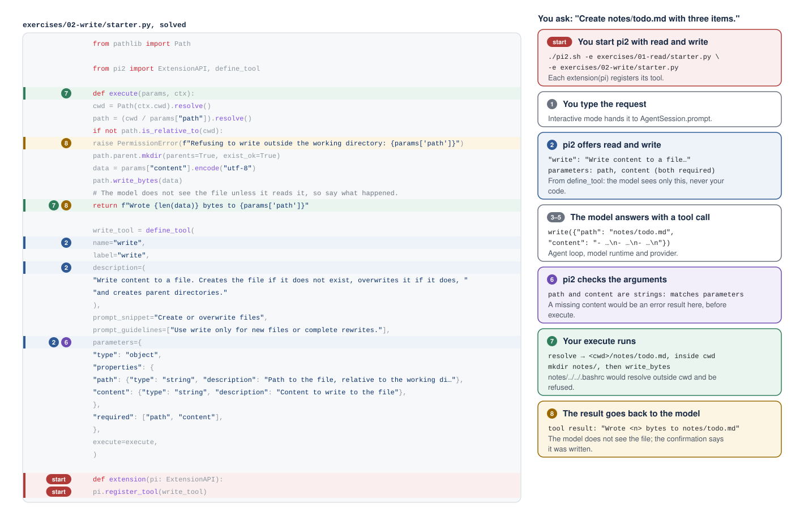
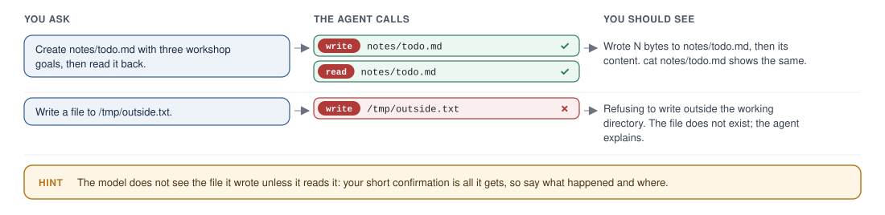

# Exercise 02: write

The agent can create files and replace them whole.

## What you learn

- What the schema already guarantees, and what `execute` must still check.
- Checking input where it enters your tool: here, where a file may be written.
- Reporting a side effect clearly, since the model does not see it otherwise.

## How it works

pi2 checks the model's arguments against `parameters` before `execute` runs. A missing `content`, or a number instead of a string, never reaches your code: the model gets an error result instead. What the schema cannot express is policy. "Only inside the working directory" is a rule about the value, not its type, so that check belongs in `execute`, and its error message is an instruction to the model.

1. The model calls `write({"path": "notes/todo.md", "content": "..."})`.
2. pi2 checks the arguments ([pi2/schema.py](../../pi2/schema.py)); invalid ones become an error result without calling `execute`.
3. `execute` resolves the path, checks it stays inside `ctx.cwd`, creates `notes/`, and writes the file.
4. The confirmation goes back to the model, which can now `read` the file or move on.

## Steps

Follow EXERCISE 1 to 4 in [write.py](write.py). Add `from pathlib import Path` at the top.

1. Resolve `params["path"]` against `ctx.cwd`.

   ```python
   cwd = Path(ctx.cwd).resolve()
   path = (cwd / params["path"]).resolve()
   ```

   `resolve()` makes the path absolute and removes `..` and symlinks, so step 2 compares real locations.

2. Refuse paths outside `ctx.cwd`.

   ```python
   if not path.is_relative_to(cwd):
       raise PermissionError(f"Refusing to write outside the working directory: {params['path']}")
   ```

   `notes/../../.bashrc` looks harmless but resolves outside `cwd`. The message says why, so the model picks another path instead of retrying the same one.

3. Create the parent directories, then write the content as UTF-8.

   ```python
   path.parent.mkdir(parents=True, exist_ok=True)
   data = params["content"].encode("utf-8")
   path.write_bytes(data)
   ```

   `parents=True` creates `notes/` and anything above it; `exist_ok=True` makes an existing folder no error. Encoding first gives the byte count for step 4.

4. Return a short confirmation.

   ```python
   return f"Wrote {len(data)} bytes to {params['path']}"
   ```

   The model does not see the file unless it reads it. The confirmation tells it the write happened.

The whole run, with the line of the solution each step uses:

<p align="center"></p>

<details>
<summary>The whole function</summary>

```python
from pathlib import Path


def execute(params, ctx):
    cwd = Path(ctx.cwd).resolve()
    path = (cwd / params["path"]).resolve()
    if not path.is_relative_to(cwd):
        raise PermissionError(f"Refusing to write outside the working directory: {params['path']}")
    path.parent.mkdir(parents=True, exist_ok=True)
    data = params["content"].encode("utf-8")
    path.write_bytes(data)
    # The model does not see the file unless it reads it, so say what happened.
    return f"Wrote {len(data)} bytes to {params['path']}"
```

</details>

## Check your tool

Before you try it with the model, check it without one:

```bash
python3 "$REPO/exercises/check.py" 02
```

Each step of the list above has checks that call your `execute()` directly. A check shows PASS, FAIL with what went wrong, or TODO while `execute()` still raises `NotImplementedError`. When all checks pass, the tool does what the steps ask. Whether the model uses the tool well is what the next section shows.

## Try it

Load it together with your read tool, from your playground copy:

```bash
cd ~/pi-workshop
"$REPO/pi2.sh" -e "$REPO/exercises/01-read/read.py" -e "$REPO/exercises/02-write/write.py"
```

Ask: "Create notes/todo.md with three workshop goals, then read it back." Then: "Write a file to /tmp/outside.txt."

<p align="center"></p>

## Expected result

- A green `write notes/todo.md` box with your confirmation, then a `read` of the same file. `cat notes/todo.md` in another terminal shows the content.
- The write to `/tmp/outside.txt` turns red with your message, the file does not exist, and the agent explains that it was refused.

## Where to look

| File | What to look at |
|---|---|
| [pi2/schema.py](../../pi2/schema.py) | `validate_tool_arguments`: what the schema guarantees before `execute` |
| [pi2/agent_loop.py](../../pi2/agent_loop.py) | `execute_tool_call`: an invalid call never reaches the tool |

## In Pi

Pi's original tool is [tools/write.ts](https://github.com/windx987/pi-2/blob/cead615b4/packages/coding-agent/src/core/tools/write.ts). Pi runs several tool calls at the same time, so writes to one file go through a queue ([file-mutation-queue.ts](https://github.com/windx987/pi-2/blob/main/packages/coding-agent/src/core/tools/file-mutation-queue.ts)). pi2 runs tool calls one after another and needs none.
