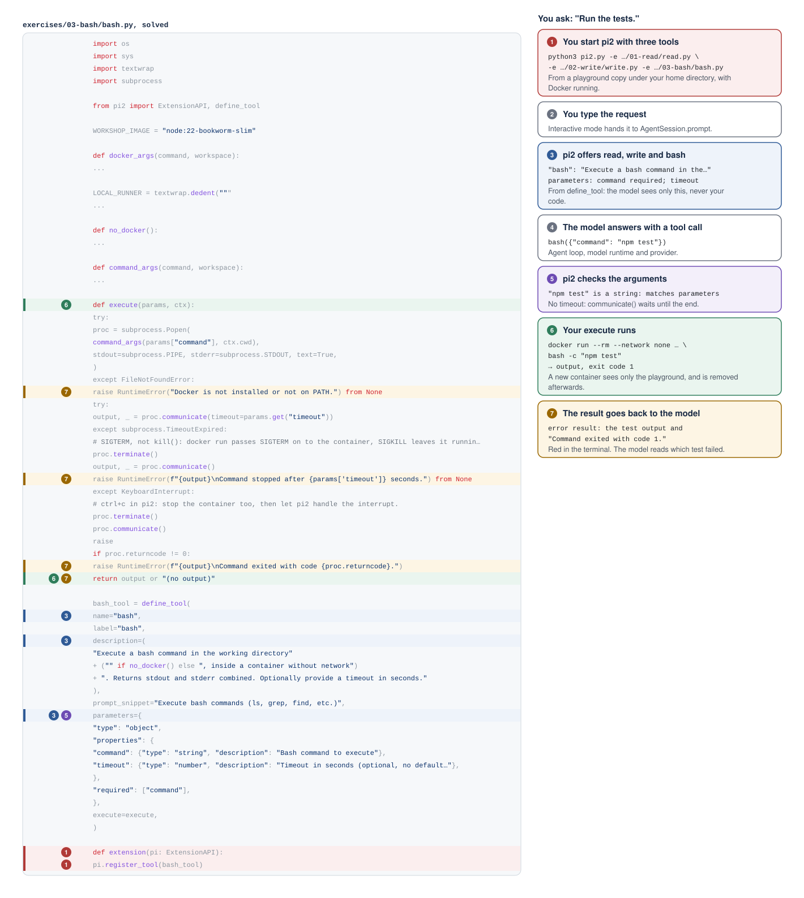
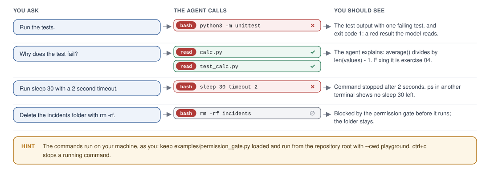

# Exercise 03: bash

Let the agent run commands. Each one runs in a new Docker container that sees only the working folder and has no network.

## What you write

`execute(params, ctx)` in [bash.py](bash.py). The container is done for you: `command_args()` builds the `docker run ...` command line. Your part is the process around it.

| Name | Is |
|---|---|
| `params["command"]` | The bash command the model wants to run, such as `npm test` |
| `params.get("timeout")` | Seconds before it is stopped (optional) |
| `ctx.cwd` | The working folder, mounted in the container at `/workspace` |

Return the output. When the command fails (exit code not 0), raise with the output and the code: the model must notice it.

## Steps

Follow EXERCISE 1 to 4 in [bash.py](bash.py). Add `import subprocess` at the top.

1. Start the command.

   ```python
   try:
       proc = subprocess.Popen(
           command_args(params["command"], ctx.cwd),
           stdout=subprocess.PIPE, stderr=subprocess.STDOUT, text=True,
       )
   except FileNotFoundError:
       raise RuntimeError("Docker is not installed or not on PATH.") from None
   ```

   `stderr=subprocess.STDOUT` puts errors in the same text as the output, in order, as a terminal shows them.

2. Wait for it, at most `timeout` seconds.

   ```python
   try:
       output, _ = proc.communicate(timeout=params.get("timeout"))
   ```

3. Stop it at the timeout, or when you press ctrl+c. These belong to the `try` of step 2:

   ```python
   except subprocess.TimeoutExpired:
       proc.terminate()
       output, _ = proc.communicate()
       raise RuntimeError(f"{output}\nCommand stopped after {params['timeout']} seconds.") from None
   except KeyboardInterrupt:
       proc.terminate()
       proc.communicate()
       raise
   ```

   Use `terminate()`, not `kill()`: `docker run` passes it on and stops the container. `kill()` stops only the `docker` client, and the container keeps running.

4. Return the output, or raise when the command failed.

   ```python
   if proc.returncode != 0:
       raise RuntimeError(f"{output}\nCommand exited with code {proc.returncode}.")
   return output or "(no output)"
   ```

The four blocks, one under the other, are the whole function:

<p align="center"></p>

<details>
<summary>The whole function</summary>

```python
import subprocess


def execute(params, ctx):
    try:
        proc = subprocess.Popen(
            command_args(params["command"], ctx.cwd),
            stdout=subprocess.PIPE, stderr=subprocess.STDOUT, text=True,
        )
    except FileNotFoundError:
        raise RuntimeError("Docker is not installed or not on PATH.") from None
    try:
        output, _ = proc.communicate(timeout=params.get("timeout"))
    except subprocess.TimeoutExpired:
        # SIGTERM, not kill(): docker run passes SIGTERM on to the container, SIGKILL leaves it running.
        proc.terminate()
        output, _ = proc.communicate()
        raise RuntimeError(f"{output}\nCommand stopped after {params['timeout']} seconds.") from None
    except KeyboardInterrupt:
        # ctrl+c in pi2: stop the container too, then let pi2 handle the interrupt.
        proc.terminate()
        proc.communicate()
        raise
    if proc.returncode != 0:
        raise RuntimeError(f"{output}\nCommand exited with code {proc.returncode}.")
    return output or "(no output)"
```

</details>

## Check

```bash
python3 ~/pi-2/exercises/check.py 03
```

Most checks need no Docker. With Docker running, a few more run in a real container; without it they are skipped.

## Try it

Start Docker (Docker Desktop, or `colima start`) and pull the image once: `docker pull node:22-bookworm-slim`. Then, from the playground copy:

```bash
cd ~/pi-workshop
python3 ~/pi-2/pi2.py -e ~/pi-2/exercises/01-read/read.py -e ~/pi-2/exercises/02-write/write.py \
  -e ~/pi-2/exercises/03-bash/bash.py
```

| Ask | You should see |
|---|---|
| Run the tests. | A red `$ npm test` box: one failing test, exit code 1 |
| Why does the test fail? | The agent reads `math.js` and the test, and explains. Fixing it is exercise 04 |
| Run `sleep 30` with a 2 second timeout. | Stopped after 2 seconds; `docker ps` shows no container left |
| Run `getent hosts example.com`. | It fails: the container has no network |

<p align="center"></p>

## Without Docker

Put `PI2_NO_DOCKER=1` in front, and the commands run with bash on your machine, as Pi's own bash tool does. Your `execute()` stays the same. You need Node.js 22 for `npm test` ([install guide](../../README.md#4-docker-or-the-no-docker-mode-for-exercise-03)).

```bash
cd ~/pi-workshop
PI2_NO_DOCKER=1 python3 ~/pi-2/pi2.py -e ~/pi-2/exercises/01-read/read.py -e ~/pi-2/exercises/02-write/write.py \
  -e ~/pi-2/exercises/03-bash/bash.py -e ~/pi-2/examples/permission_gate.py
```

Nothing isolates the commands then: they see your files and your network, and a wrong `rm` is a real one. Work only in the playground copy, keep the [permission gate](../../examples/permission_gate.py) loaded, and read what the agent runs. Try `curl -sI https://example.com`: it answers.

## Isolation checks

What the container should stop, and a command to check each. Verified with Colima on macOS; other setups are not verified yet.

| Check | Command | Expected |
|---|---|---|
| No network | `getent hosts example.com` | Fails |
| No host files | `ls /Users /home; cat /etc/hostname` | No home folders; the container's hostname |
| Memory limit | `node -e "const a=[]; for(;;) a.push(Buffer.alloc(1e8, 1))"` | Killed (exit code 137) at about 1 GB |
| Process limit | `cat /sys/fs/cgroup/pids.max` | `256` |
| Timeout | `sleep 300` with `timeout: 2`, then `docker ps` | No container left |
| Symlinks | `ln -s / host-root && ls host-root/` | The container's root, not your machine's |

The container protects only commands. Your `read`, `write` and `edit` run on your machine, and a symlink in the working folder can lead them outside it.

## Read more

- [examples/permission_gate.py](../../examples/permission_gate.py): a rule that blocks dangerous commands before your tool runs.
- [pi2/agent_loop.py](../../pi2/agent_loop.py): `execute_tool_call`, where ctrl+c reaches your tool as `KeyboardInterrupt`.
- Pi's own `bash` runs on the host and streams output: [tools/bash.ts](https://github.com/windx987/pi-2/blob/cead615b4/packages/coding-agent/src/core/tools/bash.ts).
