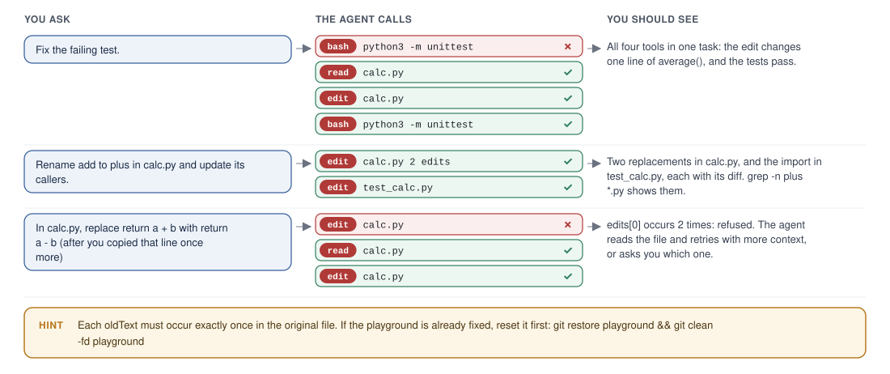

# Exercise 04: edit

Let the agent change part of a file without rewriting all of it.

## What you write

`execute(params, ctx)` in [edit.py](edit.py). The model names the exact text to replace, not a line number: line numbers move after every edit.

| Name | Is |
|---|---|
| `params["path"]` | The file to change |
| `params["edits"]` | A list of `{"oldText": ..., "newText": ...}` |
| `ctx.cwd` | The working folder |

The rule: each `oldText` must occur exactly once in the file. Not found means the model's copy is out of date; found twice means the edit is ambiguous. Both are errors that tell the model to read the file again or add more context.

## Steps

Follow EXERCISE 1 to 4 in [edit.py](edit.py):

1. Find the file and read it.
2. Find each `oldText` exactly once (`str.count`). Name the failing edit in the error: `edits[0]`, `edits[1]`, ...
3. Refuse edits that overlap, then replace from the end of the file to the start, so earlier positions stay right.
4. Write the file and say what changed; `difflib.unified_diff` gives a diff.

Match every edit against the original file, not one after another: the model plans all of them from one read.

## Check

```bash
python3 exercises/check.py 04
```

## Try it

Load all four tools from the repository root:

```bash
python3 pi2.py --cwd playground -e exercises/01-read/read.py -e exercises/02-write/write.py \
  -e exercises/03-bash/bash.py -e exercises/04-edit/edit.py
```

| Ask | You should see |
|---|---|
| Fix the failing test. | `python3 -m unittest` fails, `read`, a green `edit calc.py`, then the tests pass |
| Rename add to plus in calc.py and update its callers. | One `edit` with two replacements, and the diff |
| In calc.py, replace `return a + b` with `return a - b` (copy that line once more first) | Red: the text occurs twice. The agent reads the file and retries with more context |

<p align="center"></p>

If the playground is already fixed, reset it: `git restore playground && git clean -fd playground`.

## Read more

- [pi2/tui.py](../../pi2/tui.py): `tool_title`, how the tool box shows the call and the first lines of the result.
- Pi's own `edit` also handles line endings and near matches: [tools/edit.ts](https://github.com/windx987/pi-2/blob/cead615b4/packages/coding-agent/src/core/tools/edit.ts).
