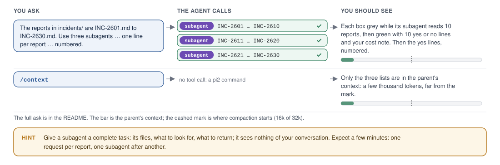

# Exercise 05: subagent (Python only)

A tool that runs a second agent. The parent gives it a task; the subagent does the reading in its own conversation and sends back only its answer.

## Why

Everything the agent reads stays in its context and is sent again with every request. Ask about 10 files:

- **Without a subagent:** all 10 files stay in the parent's context.
- **With a subagent:** the subagent reads them in its own context, and the parent gets one paragraph.

## What you write

`execute(params, ctx)` in [subagent.py](subagent.py).

| Name | Is |
|---|---|
| `params["task"]` | What the subagent must do, in full: it does not see your conversation |
| `ctx.session` | The parent's running session: its model, runtime and tools |

## Steps

Follow EXERCISE 1 to 4 in [subagent.py](subagent.py):

1. Give the subagent the parent's tools, except `subagent` itself.
2. Start a new `AgentSession` with no messages, and call `prompt(task)`. It runs a whole agent loop.
3. If the subagent failed, raise its error. If you pressed ctrl+c, raise `KeyboardInterrupt` so the parent stops too.
4. Return the text of its last message, with a note on what it cost.

## Check

```bash
python3 exercises/check.py 05
```

A fake model plays the subagent, so no model is needed.

## Try it

Load your read tool and the subagent from the repository root. The subagent has only the tools you load, so `read` must work first.

```bash
python3 pi2.py --cwd playground -e exercises/01-read/read.py -e exercises/05-subagent/subagent.py
```

[incidents/](../../playground/incidents/) has 30 reports, about 25k tokens: too many for one 32k context, while 10 fit in each subagent. Ask:

"The reports in incidents/ are INC-2601.md to INC-2630.md. Use three subagents: the first reads INC-2601.md to INC-2610.md, the second INC-2611.md to INC-2620.md, the third INC-2621.md to INC-2630.md. Each one reads the Root cause section of every report, not the logs, and returns one line per report: the incident number, the date, the root cause, and yes if the root cause says the database failed, no if something else did. Then list the yes lines, numbered."

| You should see | Why |
|---|---|
| Three `subagent` boxes, grey while they work, then green with 10 lines and `[subagent: 10 tool calls, …k input tokens]` | Each subagent reads its 10 reports |
| The yes lines, numbered | The parent answers from the three lists, without reading a report |
| `/context` grows by the three lists only | The reports stayed in the subagents |

<p align="center"></p>

Name the files: no tool can list a folder. Ask for a line per report and numbered lines: a skipped report then shows, and a model numbers better than it counts. It takes a few minutes. [Scenario 2](../../playground/README.md#2-thirty-incident-reports) has more.

## Read more

- [pi2/session.py](../../pi2/session.py): `AgentSession`, what the subagent runs.
- [pi2/extensions.py](../../pi2/extensions.py): `ToolContext`, where `ctx.session` comes from.
- Pi's own subagent example starts a separate `pi` process per task: [examples/extensions/subagent/](https://github.com/windx987/pi-2/tree/main/packages/coding-agent/examples/extensions/subagent).
