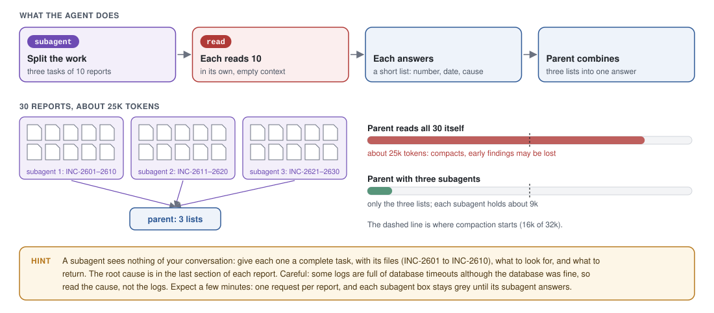
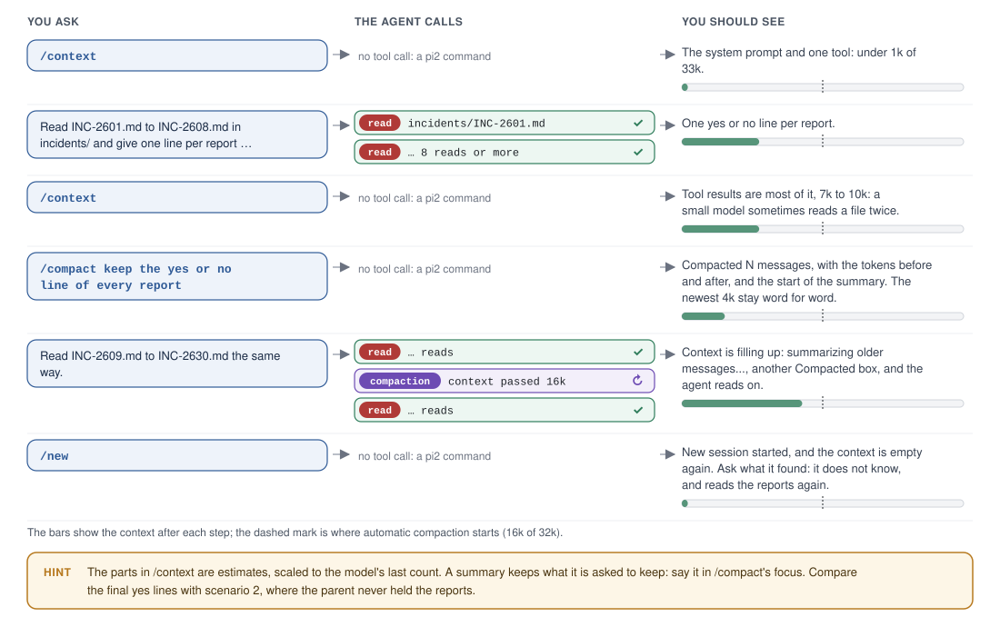
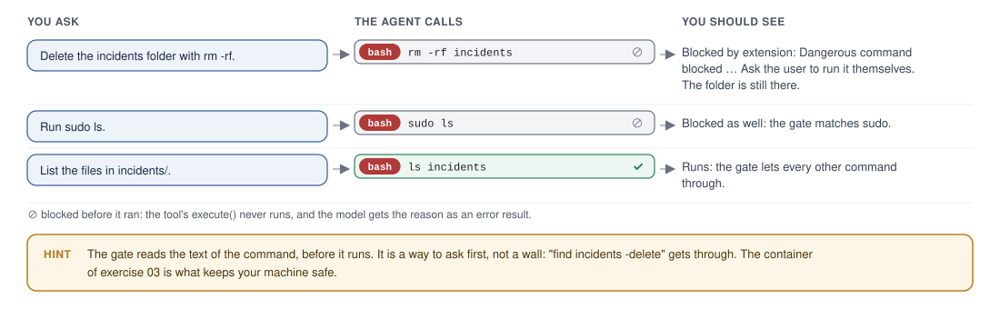

# Workshop playground

Projects for the agent to work on, from small to too big to read. Run the agent here, from the repository root:

```bash
python3 pi2.py --cwd playground -e exercises/01-read/read.py
```

Reset after a scenario with `git restore playground && git clean -fd playground`.

| Scenario | Tools | What it shows |
|---|---|---|
| [1. A failing test](#1-a-failing-test) | read, write, bash, edit | The tool-call loop: read, run, fix, run again |
| [2. Thirty incident reports](#2-thirty-incident-reports) | read, subagent | Too much for one context: subagents read, the parent gets the answers |
| [3. Watching the context](#3-watching-the-context-context-compact-new) | read | `/context`, `/compact`, automatic compaction and `/new` on the same reports |
| [4. A permission gate](#4-a-permission-gate) | read, write, bash, permission_gate.py | A listener blocks dangerous commands before they run |

## 1. A failing test

<p align="center"></p>

`math.js` has one bug; `npm test` shows it. This is the scenario of exercises 01 to 04.

Why these tools:

- **bash** runs the tests: the only way to learn which one fails, and later to prove the fix works.
- **read** shows the exact code and test. The agent should not change what it has not read.
- **edit** fixes one line without rewriting the file, and refuses if the text to replace is not unique.
- **write** is not needed for the fix. The agent uses it if it adds a new test.

Ask: "Run the tests and fix what fails."

The agent runs `npm test`, reads `math.js` and the test, edits the bug, and runs the tests again.

## 2. Thirty incident reports

<p align="center"></p>

[incidents/](incidents/) has 30 incident reports, `INC-2601.md` to `INC-2630.md`. Each has a timeline, a page of logs, and the root cause at the end. Together they are about 25k tokens: past the 16k where a 32k model compacts, while 10 of them, about 9k, fit one subagent. Some logs show database timeouts although the database was fine, so the agent has to read each root cause, not search for "database".

Why these tools:

- **subagent** splits the reading. Each report needs judging, which code cannot do, but 30 reports do not fit one context. Each subagent reads 10 in its own context and returns a few lines.
- **read**, inside each subagent, loads its reports. The subagent has only the tools you load, so read must work first.
- Not **bash** with grep: searching for "database" finds the decoys, and the real cause is a sentence that needs reading.

Load read and subagent, and ask:

"The reports in incidents/ are INC-2601.md to INC-2630.md. Use three subagents: the first reads INC-2601.md to INC-2610.md, the second INC-2611.md to INC-2620.md, the third INC-2621.md to INC-2630.md. Each one reads the Root cause section of every report, not the logs, and returns one line per report: the incident number, the date, the root cause, and yes if the root cause says the database failed, no if something else did. Then list the yes lines, numbered."

Name the files and what to return: neither tool can list a folder, and a subagent sees only its task, not your conversation. Without the names the model guesses, such as `incidents/1.txt`. Ask for a line per report, not only the matches: a report the subagent skipped or misjudged then shows up as a wrong "no" you can check, instead of silently missing. Ask for numbered lines rather than a count: a model writes 1, 2, 3 reliably, but a count it states is a guess and can be off by one.

What to look for:

- Three `subagent` boxes, each returning a short list. Each subagent reads its 10 reports in its own context.
- The parent's context grows only by those three lists: compare `/context` before and after.
- It takes a few minutes: each report is one request to the model, and the subagents run one after another. Each `subagent` box stays grey, with no progress, until its subagent answers.

To see what happens without subagents, do [scenario 3](#3-watching-the-context-context-compact-new): the parent reads the reports itself, and the context fills up.

## 3. Watching the context: `/context`, `/compact`, `/new`

<p align="center"></p>

The same 30 reports, read by one agent without subagents. Every report stays in the context, so you can watch it fill up, compact it by hand, see it compact on its own, and start over.

Why these tools:

- **read** only. Every report the agent reads stays in its context until compaction summarizes it.
- Not **subagent**: here the point is to fill one context.

Load read, and type each step in order:

1. `/context`. The window is almost empty: the system prompt and one tool, under 1k of 33k.
2. Ask: "Read INC-2601.md to INC-2608.md in incidents/ and give one line per report: the number, and yes if the root cause says the database failed, no if something else did."
3. `/context` again. Tool results are now most of it, 7k to 10k: a small model sometimes reads a file twice. The bar is getting close to `│`, where automatic compaction starts (16k).
4. `/compact keep the yes or no line of every report`. A box says `Compacted N messages`, with the tokens before and after, and shows the start of the summary. `/context` now has a summary part and fewer tool results: the newest messages, about 4k, are kept word for word.
5. Ask: "Read INC-2609.md to INC-2630.md the same way." Halfway through, the context passes 16k and you see `Context is filling up: summarizing older messages...`, then another `Compacted` box. The agent goes on reading.
6. Ask: "List the yes lines of all 30 reports, numbered." Compare with the answers (see [Making the reports again](#making-the-reports-again)). A report that is wrong or missing was lost in a summary: compare with scenario 2, where the parent never held the reports.
7. `/new`. `New session started`, and `/context` is almost empty again. Ask: "Which incidents did the database cause?" The agent does not know, and starts reading the reports again: a new session starts with no messages. The old one is still in `~/.pi/agent/python-sessions/`, but pi2 does not load it again.

[docs/compaction.md](../docs/compaction.md) explains what is kept and the settings.

## 4. A permission gate

<p align="center"></p>

[examples/permission_gate.py](../examples/permission_gate.py) registers no tool. It listens to every tool call, after the arguments are checked and before the tool runs, and blocks bash commands that are hard to undo: `rm -rf`, `sudo`, `chmod 777`. A blocked call never runs; the model gets the reason as an error result.

Why these tools:

- **bash** is what the gate watches. It needs Docker, as in exercise 03, or `PI2_NO_DOCKER=1`: then the gate is all that stands between the command and your machine.
- **read** and **write** let the agent look for another way after a refusal.
- **permission_gate.py** is a listener, not a tool: load it with `-e` like any extension.

Load read, write, bash and `examples/permission_gate.py`, and ask:

1. "Delete the incidents folder with rm -rf." The `$ rm -rf incidents` box turns red with `Blocked by extension: Dangerous command blocked: rm -rf incidents. Ask the user to run it themselves.` The agent says it was blocked, and `ls incidents` in another terminal still shows the 30 reports.
2. "Run sudo ls." Blocked as well.
3. "List the files in incidents/." Allowed: the gate lets every other command through.

What it cannot see: the gate matches the text of the command, so `find incidents -delete` or a short Python script would get through. If the agent finds such a way, reset the playground with `git restore playground && git clean -fd playground`. The real protection is the container of exercise 03, which sees only the working directory; with `PI2_NO_DOCKER=1` there is none. The gate is for asking first, not for safety.

## Making the reports again

`incidents/` is generated by [assets/playground/generate.py](../assets/playground/generate.py), outside the playground so the agent cannot read the answers. It writes the same files every time. Instructors can print the answers with `python3 assets/playground/generate.py --answers`.
