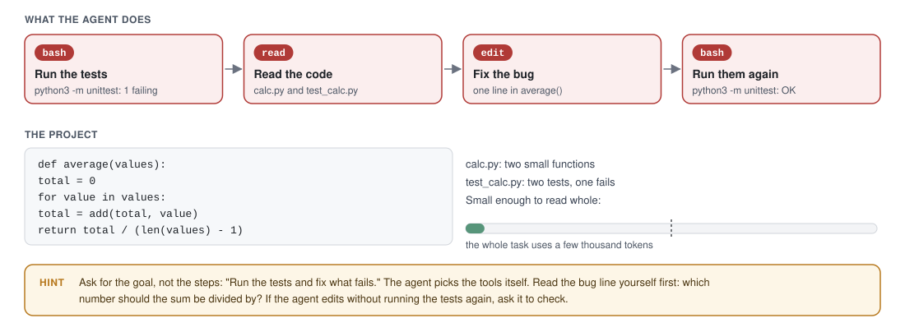
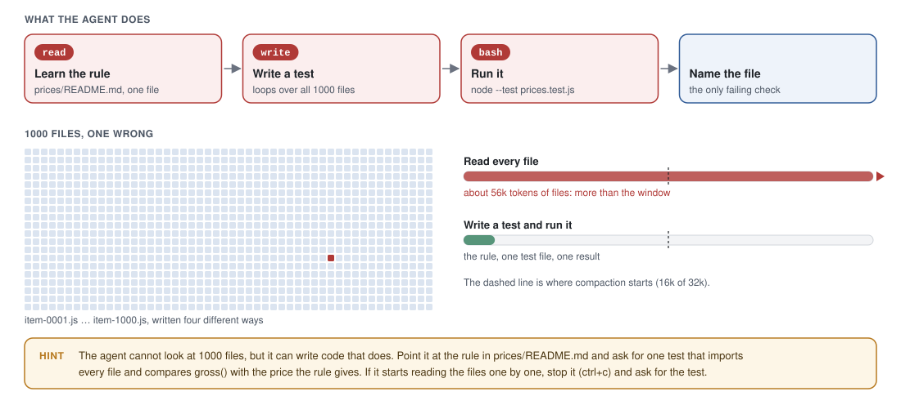
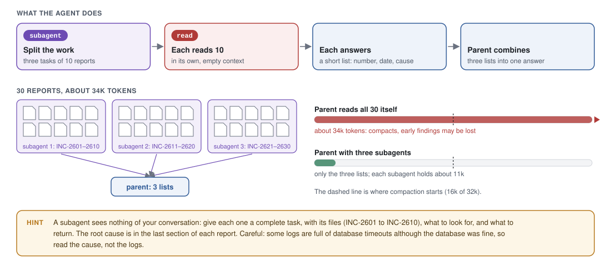

# Workshop playground

Projects for the agent to work on, from small to too big to read. Work on a copy, so the agent's changes never touch the repository:

```bash
cp -R playground ~/pi-workshop
cd ~/pi-workshop
```

| Scenario | Tools | What it shows |
|---|---|---|
| [1. A failing test](#1-a-failing-test) | read, write, bash, edit | The tool-call loop: read, run, fix, run again |
| [2. One bug in 1000 files](#2-one-bug-in-1000-files) | read, write, bash | When there is too much to read, the agent writes code to check it |
| [3. Thirty incident reports](#3-thirty-incident-reports) | read, subagent | Too much for one context: subagents read, the parent gets the answers |

## 1. A failing test

<p align="center"></p>

`math.js` has one bug; `npm test` shows it. This is the scenario of exercises 01 to 04.

Why these tools:

- **bash** runs the tests: the only way to learn which one fails, and later to prove the fix works.
- **read** shows the exact code and test. The agent should not change what it has not read.
- **edit** fixes one line without rewriting the file, and refuses if the text to replace is not unique.
- **write** is not needed for the fix. The agent uses it if it adds a new test.

Ask: "Run the tests and fix what fails."

The agent runs `npm test`, reads `math.js` and the test, edits the bug, and runs the tests again.

## 2. One bug in 1000 files

<p align="center"></p>

[prices/](prices/) has 1000 files, `item-0001.js` to `item-1000.js`. Each exports a net price and a function `gross()` that adds 7% VAT. One of them is wrong, and they are written in four different ways, so you cannot spot it by looking. [prices/README.md](prices/README.md) says what every file must do.

Why these tools:

- **read** for the rule in `prices/README.md` and one or two files to see their shape, not for all 1000: together they are more than the context holds.
- **write** creates the test, a new file.
- **bash** runs it. The 1000 checks happen inside Node, outside the model's context, and only the result comes back: one failing file instead of 56k tokens of code.
- Not **subagent**: splitting the files between subagents would still read every one of them. A checkable rule is a job for code.

Load read, write and bash, and ask:

"One of the 1000 files in prices/ computes the wrong price. Read prices/README.md, write a test that checks every file against it, run it, and tell me which file is wrong."

What to look for:

- The agent reads the README and one or two files, not all 1000: they would not fit in its context. Type `/context` to see why.
- It writes a test, for example `prices.test.js`, that loops over the folder, then runs it with `node --test prices.test.js`.
- The test fails for exactly one file, and the agent names it. With edit loaded, ask it to fix the file and run the test again.

## 3. Thirty incident reports

<p align="center"></p>

[incidents/](incidents/) has 30 incident reports, `INC-2601.md` to `INC-2630.md`. Each has a timeline, a page of logs, and the root cause at the end. Together they are about 25k tokens: past the 16k where a 32k model compacts, while 10 of them, about 9k, fit one subagent. Some logs show database timeouts although the database was fine, so the agent has to read each root cause, not search for "database".

Why these tools:

- **subagent** splits the reading. Each report needs judging, which code cannot do, but 30 reports do not fit one context. Each subagent reads 10 in its own context and returns a few lines.
- **read**, inside each subagent, loads its reports. The subagent has only the tools you load, so read must work first.
- Not **bash** with grep: searching for "database" finds the decoys, and the real cause is a sentence that needs reading.

Load read and subagent, and ask:

"The reports in incidents/ are INC-2601.md to INC-2630.md. Use three subagents: the first reads INC-2601.md to INC-2610.md, the second INC-2611.md to INC-2620.md, the third INC-2621.md to INC-2630.md. Each one reads the Root cause section of its reports, not the logs, and returns the incidents the database caused, with the incident number, the date and the cause. Then combine the three lists."

Name the files and what to return: neither tool can list a folder, and a subagent sees only its task, not your conversation. Without the names the model guesses, such as `incidents/1.txt`.

What to look for:

- Three `subagent` boxes, each returning a short list. Each subagent reads its 10 reports in its own context.
- The parent's context grows only by those three lists: compare `/context` before and after.
- It takes a few minutes: each report is one request to the model, and the subagents run one after another. Each `subagent` box stays grey, with no progress, until its subagent answers.

Then start a new session with `/new` and ask the same without subagents: "Read every report in incidents/, INC-2601.md to INC-2630.md, and tell me which incidents the database caused." The context fills up, the session compacts (see [docs/compaction.md](../docs/compaction.md)), and findings from the early reports may be lost in the summary.

## Making the scenarios again

`prices/` and `incidents/` are generated by [assets/playground/generate.py](../assets/playground/generate.py), outside the playground so the agent cannot read the answers. It writes the same files every time. Instructors can print the answers with `python3 assets/playground/generate.py --answers`.
